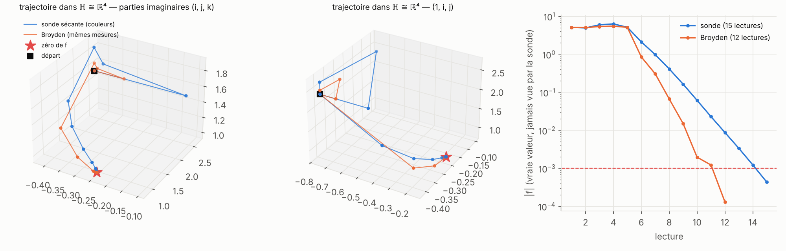
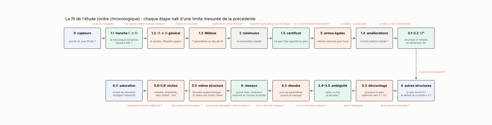
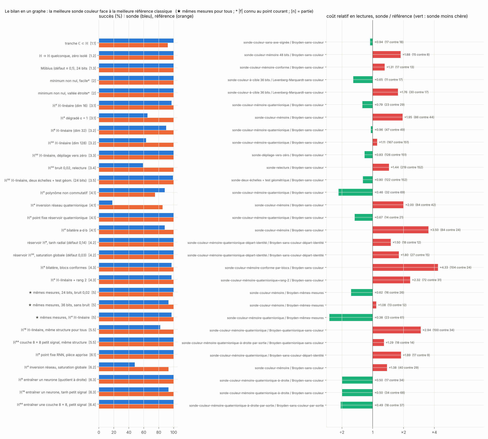
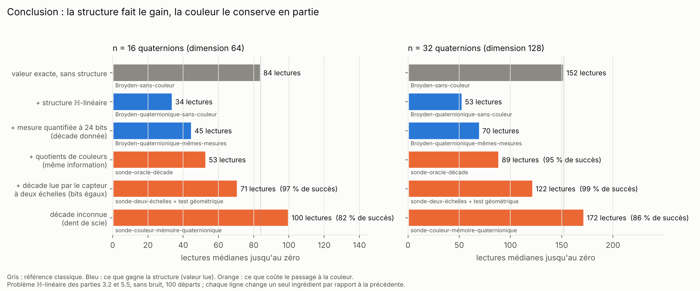

# Optimiser avec des couleurs quaternioniques

*quaternionic-colorimetry-optimization*

**Peut-on trouver les zéros d'une fonction f : ℍ → ℍ, ou minimiser une perte, en ne regardant que la couleur de f(q) ?**

Ce travail prolonge [`complex-colorimetry-optimization`](https://github.com/mathisfrinzi/complex-colorimetry-optimization) aux quaternions. La règle du jeu ne change pas : nos algorithmes, les **sondes**, ne lisent jamais la valeur de `f`. Ils ne voient qu'une couleur quantifiée sur `B` bits : la **luminosité** donne `log|f|` à une décade près, l'**angle** donne l'écart de `f` à l'axe réel, et l'**axe** (la direction de la partie imaginaire, un point de la sphère S²) est l'information que le complexe n'avait pas. On compare chaque fois aux méthodes classiques (Newton, Broyden, BFGS, Levenberg-Marquardt, Nelder-Mead, CMA-ES) à **nombre de lectures égal**, et entre capteurs à **nombre de bits égal**.

**Comment lire les noms.** `sonde-…` désigne un de nos algorithmes (`sonde-couleur-…` lit une couleur). `…-sans-couleur` désigne une méthode classique qui lit la **valeur exacte** de `f`. `…-mêmes-mesures` désigne une méthode classique qui lit **la même mesure dégradée** que la sonde. `Broyden-quaternionique-…` désigne une méthode classique qui connaît **la même structure** que la sonde. Le détail est en [partie 0](parties/0_capteurs_et_sondes/README.md).

## Réponse courte

**Oui, on peut optimiser avec les seules couleurs, mais la couleur ne bat pas la valeur.** Ce qui fait gagner en dimension 4n, c'est la structure quaternionique de la jacobienne ; la couleur suffit à l'exploiter, pour un surcoût modéré. Ce qu'elle apporte en propre est un certificat topologique.

- **0. La mécanique se transpose.** Deux lectures donnent un quotient `ρ = F(q)⁻¹F(q+h)` où les modules s'éliminent, et l'équation de Newton devient `W h = −1`. L'axe en deux angles lit mieux que l'axe en RVB.
- **1. Zéros en dimension 4 : la sonde ne bat pas Broyden.** Sur une tranche ℂ ⊂ ℍ, elle retrouve le comportement du complexe (100 % en 17 lectures). Sur une fonction quelconque, la meilleure sonde coûte environ deux fois plus de lectures que Broyden-sans-couleur. **Mais l'axe donne une garantie topologique** : le degré de `f`, lu dans les seules directions de couleur, prouve qu'il y a un zéro dans une boule (≈ 100 % avec 192 lectures, même bruitées).
- **2. Minimums : gain partiel.** Une sonde-couleur-à-cible bat BFGS-sans-couleur, pas Levenberg-Marquardt-sans-couleur, et seulement si `|f|` est connu au point courant.
- **3. Dimension 4n : la structure ℍ-linéaire se lit dans les couleurs.** Une sonde dans la direction 1 donne un coefficient quaternionique entier : n sondes au lieu de 4n. La sonde bat alors Broyden-sans-couleur, qui ignore la structure, jusqu'à n ≈ 8. Au-delà, l'**ambiguïté de la luminosité** (la dent de scie) la freine ; un capteur à deux échelles, à bits égaux, la supprime (n = 32 : 122 lectures contre 152).
- **4. Autres structures : la règle du défaut.** Le gain survit sur des objets non construits pour (réservoirs, polynômes non commutatifs) tant que la jacobienne reste proche de la structure (défaut ≲ 0,15), et disparaît vers 0,4.
- **5. À armes égales, la couleur suffit mais ne gagne pas.** À mesure égale, la sonde bat Broyden-mêmes-mesures en dimension 4n. Mais un **Broyden quaternionique** qui connaît la même structure et lit la valeur est le moins cher partout (34 lectures à n = 16 contre 53 à 100 pour les sondes). Trois situations qui semblaient favorables à la couleur ne le sont pas : une boîte noire mal conditionnée, un capteur d'amplitude peu fiable, un zéro qui bouge.
- **6. Réseaux quaternioniques : la structure est dans la place des poids.** La jacobienne d'un neurone par rapport à ses poids est une multiplication **à droite**, celle d'une couche est en plus diagonale par sortie : p sondes suffisent quel que soit le nombre de sorties (11 à 18 lectures jusqu'à la dimension 256). Le Broyden quaternionique correspondant fait mieux (6 à 10 lectures) et tient en régime saturé, où la sonde s'effondre surtout à cause de son test de descente. Chaque point fixe d'un RNN trouvé par la sonde est **certifié** par le degré lu dans les couleurs (13 sur 13).

## L'idée en quatre images

**1. Le capteur.** Un quaternion s'écrit `F = r·e^{uθ}`. La luminosité porte `r` (en dent de scie : tous les bits servent à la précision fine), la teinte porte `θ`, l'axe `u` se lit en RVB ou en deux angles.


**2. La sonde.** Deux couleurs donnent un quotient `ρ`, les quotients donnent la jacobienne normalisée `W = F⁻¹J`, et `W h = −1` donne un pas de Newton complet sans jamais connaître `f`. Les sondes ne diffèrent que par la façon d'obtenir `W` : la relire à chaque pas (sonde-couleur), la mettre à jour avec une seule lecture par pas (sonde-couleur-mémoire), ou en lire moins grâce à une structure.


**3. Pourquoi une structure peut aider.** Une jacobienne quelconque a 16 paramètres. Une jacobienne conforme `h ↦ αhβ` n'en a que 7 et garde les cercles ; une jacobienne ℍ-linéaire sur ℍⁿ en a 4n² au lieu de 16n². Moins de paramètres, moins de sondes.


**4. Une vraie descente** dans ℍ ≅ ℝ⁴ (deux projections 3D), avec un capteur à 36 bits : la sonde (15 lectures) contre Broyden lisant les mêmes mesures (12 lectures).



## Le plan

| partie (une page chacune) | contenu |
|---|---|
| [**0. Capteurs et sondes**](parties/0_capteurs_et_sondes/README.md) | notations, noms, capteurs, sondes, ce qu'on lit avec `B` bits, glossaire |
| [**1. Zéros**](parties/1_zeros/README.md) | tranche ℂ ⊂ ℍ · fonctions quelconques · structure conforme · améliorations · certificat de zéro |
| [**2. Minimums**](parties/2_minimums/README.md) | sonde à cible scalaire puis quaternionique, ablation des canaux, sans `\|f\|` connu |
| [**3. Dimension 4n**](parties/3_dimension_4n/README.md) | jacobienne ℍ-linéaire · grande dimension · pourquoi ça décroche · relecture · deux échelles et test de descente |
| [**4. Autres structures**](parties/4_autres_structures/README.md) | polynômes, réseaux, réservoirs · défaut contrôlé · structures étendues (blocs conformes, rang faible, boîte grise) |
| [**5. À armes égales**](parties/5_armes_egales/README.md) | mêmes mesures pour tous · même structure pour tous (Broyden quaternionique) · boîte instable · amplitude peu fiable · zéro mobile |
| [**6. Réseaux quaternioniques**](parties/6_reseaux/README.md) | points fixes d'un RNN et certificat · inverser un réseau · entraîner un neurone puis une couche · pourquoi la sonde s'effondre en régime saturé |

Chaque fois qu'un élément s'ajoute à la sonde (l'axe, la mémoire, la structure conforme, le dithering, la cible, la structure ℍ-linéaire, le dépliage vers zéro, la relecture, les deux échelles, le test géométrique, le départ identité, les structures étendues, le quotient à droite, la lecture par sortie), sa partie montre **dans l'espace (i, j, k)** la même descente sans puis avec cet élément, sur un départ où il aide, avec la courbe de convergence et le nombre de départs où il aide vraiment. La partie 5 fait de même pour ce qui remplace la couleur par la valeur (Broyden quaternionique, mesure absolue, suivi d'un zéro mobile), et la partie 6.5 pour le test de descente (`schemas/make_ijk.py`).

À côté : [**fausses pistes**](fausses-pistes/README.md) (ce qui n'a pas marché, et pourquoi) et [**références**](docs/REFERENCES.md).

L'étude ne s'est pas faite dans cet ordre : chaque étape est née d'une limite mesurée de la précédente.



## Les résultats en un graphe

Pour chaque situation, la meilleure sonde face à la meilleure référence classique. À gauche le succès, à droite le coût relatif.



Sauf pour les lignes marquées ★ et celles de la partie 5.5, la référence lit la **valeur exacte** de `f` en double précision et ignore la structure (…-sans-couleur), alors que la sonde lit un capteur quantifié.

| situation | verdict | chiffres clés | partie |
|---|---|---|---|
| ce qu'on lit avec `B` bits | axe en 2 angles > RVB | couleur-complète-angles : 12,7 % d'erreur à 24 bits, 1,6 % à 36 ; capteur-valeurs illisible sous 32 bits | [0](parties/0_capteurs_et_sondes/README.md) |
| tranche ℂ ⊂ ℍ (test de cohérence) | **très bien** | sonde-couleur-sans-axe-signée 24 bits : 100 % en 17 lectures ; sans le signe de l'angle : 59 % | [1.1](parties/1_zeros/README.md#11-la-tranche-ℂ--ℍ-test-de-cohérence) |
| ℍ → ℍ quelconque | pas d'avantage | meilleure sonde 15 lectures, Broyden-sans-couleur 8 ; sans axe, échec si mal conditionné (2–9 %) | [1.2](parties/1_zeros/README.md#12-fonctions-quelconques-ℍ--ℍ) |
| Möbius, presque conforme | gain étroit | −40 % de lectures à 24 bits si défaut ≤ 0,1 ; +60 % à 36 bits ; Broyden-sans-couleur reste devant | [1.3](parties/1_zeros/README.md#13-structure-conforme-möbius) |
| améliorer la sonde | un peu | dithering : −10 à −12 % de lectures (3 cas sur 4) ; démarrage conforme et région de confiance : perdent | [1.4](parties/1_zeros/README.md#14-trois-idées-pour-améliorer-la-sonde) |
| certificat de zéro (degré topologique) | **réussi** | 100 % avec 192 lectures, 99 % avec bruit 0,2 ; 32 lectures ne suffisent pas | [1.5](parties/1_zeros/README.md#15-certificat-de-zéro-le-degré-topologique-lu-dans-les-couleurs) |
| minimum non nul | partiel | sonde-couleur-à-cible quaternionique : 11 / 30 lectures (BFGS 41 / 56, Levenberg-Marquardt 17), **seulement si `\|f\|` est connu au point courant** | [2](parties/2_minimums/README.md) |
| ℍⁿ, jacobienne ℍ-linéaire, n ≤ 4 | gagne contre Broyden sans structure | n = 4 : 23 lectures contre 29 pour Broyden-sans-couleur | [3.1](parties/3_dimension_4n/README.md#31-jacobienne-ℍ-linéaire-n--1-à-4) |
| ℍⁿ, n = 8 à 32 (dimension 32 à 128) | l'avantage plafonne puis s'inverse | n = 8 : 47 contre 49 (90 % contre 100 %) ; n = 16 : 97 contre 84 ; n = 32 : 167 contre 151 (63 %), 7 % avec bruit | [3.2](parties/3_dimension_4n/README.md#32-grande-dimension-n--8-16-32) |
| pourquoi ça décroche | **l'ambiguïté de la luminosité** | levée par oracle : 100 % à n = 32 en 88 lectures ; sonde-dépliage-vers-zéro : 100 % en 125 sans bruit, 17 % avec bruit | [3.3](parties/3_dimension_4n/README.md#33-pourquoi-la-sonde-décroche) |
| lever l'ambiguïté sans oracle | **relecture fiable mais chère ; deux échelles : plus d'ambiguïté** | relecture : 59 % à n = 32 avec bruit (1 % sans remède) ; deux échelles + test géométrique (24 bits) : 99 % à n = 32 sans bruit, 122 lectures contre 152, mais 44 % avec bruit | [3.4–3.5](parties/3_dimension_4n/README.md#34-lever-lambiguïté-sans-oracle--la-relecture) |
| objets non construits pour la structure | **gagne si le défaut est petit** | réservoir (défaut 0,14) : 14 lectures contre 21 ; polynôme non commutatif : −43 % ; inversion d'un réseau (défaut 0,5) : échec | [4.1](parties/4_autres_structures/README.md#41-objets-non-construits-pour-la-structure) |
| réservoirs : défaut contrôlé | le défaut se contrôle, la sonde ne gagne pas | défaut 0,02–0,06 ; 2,5 à 6 fois moins que Broyden-sans-couleur en boîte noire, 1,2 à 2 fois plus que Broyden-départ-identité | [4.2](parties/4_autres_structures/README.md#42-réservoirs--contrôler-le-défaut) |
| structures étendues | rattrapent le succès, pas le coût | bilatère : 0 % → 97 % (blocs conformes) ; ℍ-linéaire + rang 2 : 55 % → 97 % ; boîte grise : 8–73 % | [4.3](parties/4_autres_structures/README.md#43-étendre-la-structure-quand-elle-manque) |
| mêmes mesures dégradées pour tous ★ | dimension 4 : non ; dimension 4n : **oui** | dimension 4 : Broyden-mêmes-mesures gagne 5 cas sur 6 ; ℍ⁴ ℍ-linéaire : 23 lectures contre 61 | [5.1–5.4](parties/5_armes_egales/README.md) |
| même structure pour tous | **la valeur est la moins chère ; la couleur suffit** | ℍ-linéaire n = 16 : Broyden quaternionique 34 lectures, même mesure dégradée 45, sonde-oracle-décade 53, sonde 71 à 100 | [5.5](parties/5_armes_egales/README.md#55-même-structure-pour-tous--la-référence-qui-manquait) |
| boîte noire instable | **la couleur perd** | conditionnement 10³ : toutes les sondes 0 %, même capteur lu comme une valeur 43–73 % | [5.6](parties/5_armes_egales/README.md#56-boîte-noire-ℍ-linéaire-instable--la-dent-de-scie-aide-t-elle-) |
| capteur d'amplitude peu fiable | **la couleur perd** | gain aléatoire σℓ = 0,2 : sondes 0–7 %, valeur absolue bruitée 100 % | [5.7](parties/5_armes_egales/README.md#57-capteur-damplitude-peu-fiable) |
| suivre un zéro mobile | **égalité** | retard ≈ 1,7 / r pour toutes les méthodes qui lisent la décade ; la sonde de base décroche | [5.8](parties/5_armes_egales/README.md#58-suivre-un-zéro-qui-bouge-optimisation-en-temps-réel) |
| points fixes d'un RNN quaternionique | bat Broyden en boîte noire, pas départ-identité ; **certificat 13/13** | n = 8, pièce apprise : 17 lectures contre 36 (Broyden-sans-couleur) et 6–10 (départ identité) | [6.1](parties/6_reseaux/README.md#61-points-fixes-dun-rnn-quaternionique) |
| inverser un réseau | **échec** | défaut 0,13–0,27 : sonde 3–50 % ; Broyden-sans-couleur 93–100 % | [6.2](parties/6_reseaux/README.md#62-inverser-un-réseau-quaternionique) |
| entraîner un neurone (quotient à droite) | gagne contre Broyden sans structure | n = 8 : 17 lectures contre 34 ; n = 16 : 33 contre 66 ; Broyden quaternionique à droite : 10 et 18 | [6.3](parties/6_reseaux/README.md#63-entraîner-un-neurone-quaternionique--le-quotient-à-droite) |
| entraîner une couche (m sorties) | **p sondes quel que soit m** | 8 × 8 (dimension 256) : 18 lectures contre 258 (Broyden-sans-couleur) et 10 (Broyden quaternionique par sortie) ; s'effondre si l'activation sature | [6.4](parties/6_reseaux/README.md#64-entraîner-une-couche-entière--la-structure-par-sortie) |
| effondrement en régime saturé | **le test de descente, pour l'essentiel** | sans test de descente : 7 → 77 % (n = 8) ; Broyden quaternionique 100 % ; reste non expliqué | [6.5](parties/6_reseaux/README.md#65-pourquoi-la-sonde-seffondre-en-régime-saturé) |

## Ce que l'axe apporte

Sur une tranche, l'axe ne sert à rien : la fonction y est complexe. En dimension 4 générale, il permet de reconstruire le quotient complet `ρ`, mais une sonde à 4 directions reste plus chère que Broyden. Là où il compte :

- **Il donne la direction de `f`, donc son degré topologique.** En peignant la sphère S³ avec la couleur de `f/|f|`, un zéro de degré ±d se voit comme d enroulements des couleurs ; compté sur une triangulation, ce degré certifie un zéro dans la boule (partie 1.5) ou un point fixe d'un RNN (partie 6.1). Aucune méthode classique du rapport ne donne ce certificat.

  

- **Il résiste au bruit.** Sur un minimum non nul, un bruit sur l'axe seul laisse 99 % de succès en vallée étroite, contre 60 % sur la luminosité et 48 % sur l'angle (partie 2).
- **Il rend la structure quaternionique lisible.** Avec l'axe, une sonde dans la direction 1 donne d'un coup tout un coefficient quaternionique de la jacobienne : n sondes au lieu de 4n (partie 3). Une différence finie sur la valeur exacte lit le même coefficient, et le Broyden quaternionique y est plus économe (partie 5.5) : la couleur **suffit**, elle n'est pas nécessaire.

## Ce qui est nouveau, et ce qui ne l'est pas

Chaque brique est connue : Newton sur `ln f`, la méthode de Broyden, les mises à jour sécantes structurées, les fonctions slice-régulières, le calcul du degré par triangulation, le dithering ([références](docs/REFERENCES.md)). Ce qui est propre à ce travail :

- la couleur d'un quaternion comme seul capteur, et la mesure de ce qu'elle coûte face aux méthodes classiques, à lectures et à bits égaux ;
- le degré topologique lu dans des couleurs quantifiées, comme certificat ;
- un **Broyden quaternionique** à structure imposée (transposition aux quaternions d'une mise à jour sécante structurée, sans version publiée trouvée ; le gain mesuré est celui qu'on attend du nombre de paramètres) : blocs `L(a)` à gauche (ℍ-linéaire), `R(b)` à droite (poids d'un neurone), diagonale par sortie (couche), avec une mise à jour sécante qui garde la structure et un côté du quotient qui suit la place de l'inconnue (le mauvais côté échoue à 0 %). Version valeur : n lectures pour démarrer au lieu de 4n, 2 à 2,5 fois moins de lectures que Broyden-sans-couleur, et elle tient en régime saturé. Version couleur (la sonde) : la même économie à partir d'une couleur quantifiée, pour 15 à 25 % de lectures de plus à information égale ;
- l'identification de ce qui limite la sonde : l'ambiguïté de la luminosité en grande dimension (un capteur à deux échelles à bits égaux la lève) et, en régime saturé, un test de descente qui pèse mal les résidus.

## Conclusion

L'étude partait de la question : une couleur quantifiée suffit-elle pour optimiser sur les quaternions, et peut-elle battre une méthode qui lit la valeur ?

**Elle suffit.** Une couleur sur 24 bits par quaternion, sans jamais lire `f`, permet de trouver des zéros en dimension 4 et 4n, de suivre un zéro mobile, de chercher les points fixes d'un RNN et d'entraîner un neurone ou une couche quaternionique. Les mêmes mécanismes que dans le complexe se transposent : quotient de deux lectures, équation `W h = −1`, mémoire de Broyden.

**Elle ne bat pas la valeur.** Les victoires sur Broyden-sans-couleur des parties 3, 4 et 6 venaient de la structure quaternionique de la jacobienne, que cette référence ignorait. Dès qu'une méthode classique connaît la même structure, elle est moins chère que toutes les sondes. Le schéma ci-dessous change un ingrédient à la fois sur le même problème : la structure divise le coût par 2,5 à 3, puis chaque étape vers la couleur (quantification, quotients, décade inconnue) en reprend une partie. Les trois situations où la couleur semblait avoir un avantage naturel (système mal conditionné, amplitude peu fiable, zéro mobile) donnent une défaite ou une égalité.



**Ce qui reste.**

1. Le **Broyden quaternionique** : lire et mettre à jour la jacobienne dans l'espace des blocs quaternioniques, du bon côté. C'est la méthode la plus économe de l'étude sur tous les problèmes structurés, avec ou sans couleur.
2. Le **certificat topologique** : le degré lu dans les couleurs prouve qu'une boule contient un zéro, ou un point fixe, et donne son indice. Il ne dépend que de la direction de `f` ; c'est la seule chose que la couleur donne et que les méthodes classiques du rapport ne donnent pas. Il ne passe pas à l'échelle au-delà de ℍ (triangulation de S^(4n−1)).
3. Une **règle** : la structure fait gagner tant que le défaut de la jacobienne reste petit (≲ 0,15), quel que soit le capteur ; au-delà, mieux vaut une méthode sans structure.
4. Deux limites identifiées de la sonde, chacune avec son remède partiel : l'ambiguïté de la luminosité (capteur à deux échelles) et le test de descente en régime saturé (le supprimer fait passer de 7 % à 77 % de succès ; le reste de l'écart n'est pas expliqué).

**Pour aller plus loin**, deux directions restent ouvertes : un certificat de zéros qui passe à l'échelle en ℍⁿ (par exemple composante par composante), et les cas où une valeur n'est vraiment pas disponible, seulement une direction ou une phase. C'est là que la couleur n'aurait pas de concurrent.

## Structure du dossier

```
README.md                  cette page
docs/REFERENCES.md         références et positionnement
schemas/                   schémas (make_schemas.py : 1 à 5, make_syntheses.py : 6 et 7, make_conclusion.py : 8) ;
                           make_ijk.py : figures (i, j, k) avec / sans chaque élément
src/                       code partagé : quaternions, capteurs, fonctions test, sondes (dimension 4 : probes.py ; ℍⁿ : sonde_hn.py,
                           avec le Broyden quaternionique), méthodes classiques, degré, bancs (bench.py, banc_hn.py), noms du rapport,
                           tableaux et figures (figs_hn.py)
vendor/                    fichiers repris du dépôt complexe (MIT)
tests/                     tests unitaires (dont test_sonde_hn.py : sonde générale, couche, Broyden quaternionique)
parties/                   une page README.md par partie ; les sous-dossiers ne contiennent que le code, les résultats et les figures
  0_capteurs_et_sondes/
  1_zeros/                 1.1_tranche/ 1.2_fonctions_quelconques/ 1.3_structure_conforme/ 1.4_ameliorations/ 1.5_certificat_degre/
  2_minimums/
  3_dimension_4n/          3.1_jacobienne_H_lineaire/ 3.2_grande_dimension/ 3.3_decrochage/ 3.4_ambiguite/ 3.5_deux_echelles/
  4_autres_structures/     4.1_hors_structure/ 4.2_reservoirs/ 4.3_structures_etendues/
  5_armes_egales/          bench_armes_egales.py, bench_meme_structure.py, bench_boite_instable.py, bench_gain_amplitude.py, bench_suivi.py
  6_reseaux/               rnn.py, bench_points_fixes.py, bench_inversion.py, bench_entrainement.py, bench_couche.py, bench_diag_sature.py
  */figures/ijk_*.png      les figures (i, j, k) de chaque partie
fausses-pistes/            ce qui n'a pas marché
```

Dans chaque partie, `bench_*.py` lance un banc et écrit `*_results.json` (les bancs longs reprennent là où ils se sont arrêtés) ; `bench_*_figs.py` ou `src/figs_hn.py` en tirent les tableaux (`*_tables.md`) et les figures (`figures/`), avec les noms du rapport.

## Lancer

```
pip install -r requirements.txt
python tests/test_quat.py                                       # un test
python parties/5_armes_egales/bench_armes_egales.py --smoke     # vérification rapide d'un banc
python schemas/make_schemas.py                                  # schémas 1 à 5
python schemas/make_syntheses.py                                # schémas 6 et 7
python schemas/make_conclusion.py                               # schéma 8
python schemas/make_ijk.py depliage                             # une figure (i, j, k) avec / sans un élément
sh run_all.sh                                                   # tout recalculer (plusieurs heures sur 2 cœurs)
```

## Limites

- Trois à dix instances par famille, 12 à 100 départs par case, réglage par quelques configurations ; le bruit de réglage vaut environ ±30 % sur le coût, d'où les comparaisons appariées et les intervalles de confiance.
- Fonctions de test synthétiques ; en partie 3, elles sont construites pour avoir la structure ℍ-linéaire (c'est la question de la partie 4).
- Hors parties 1.4 et 5 et des colonnes « …-mêmes-mesures » et « Broyden-quaternionique-… », les méthodes classiques lisent la valeur exacte de `f` et ignorent la structure.
- Le gain sur les minimums non nuls suppose `|f|` connu au point courant.
- À partir de la partie 3.5, les sondes gardent les réglages de la partie 3.1 ; quelques cases ne sont pas faites faute de temps de calcul (signalées dans chaque partie).
- Revue de littérature non systématique.

## Licence

Fichiers repris du dépôt complexe : MIT (`vendor/complex_colorimetry/LICENSE`). © Mathis Frinzi, [github.com/mathisfrinzi](https://github.com/mathisfrinzi).
