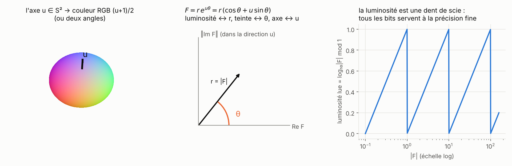
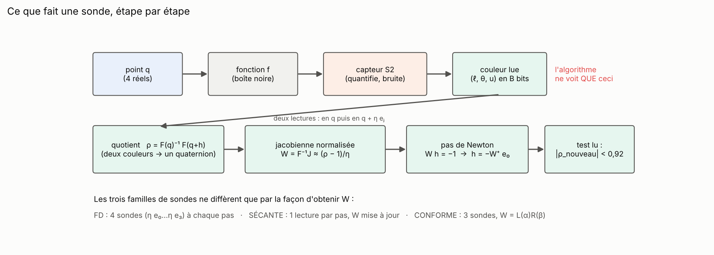
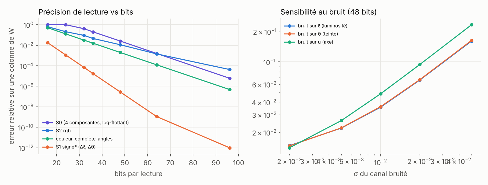

# Partie 0 : capteurs et sondes

> **En bref.** Un quaternion non nul s'écrit `F = r·e^{uθ}`. Le capteur en garde la luminosité (`log r` modulo une décade), l'angle `θ` et, s'il en a les bits, l'axe `u` (un point de la sphère S²). Deux lectures donnent un quotient `ρ = F(q)⁻¹F(q+h)` dans lequel les modules s'éliminent, d'où la jacobienne normalisée `W` et le pas de Newton `W h = −1`. Cette partie fixe les notations et les noms utilisés dans tout le rapport, décrit les capteurs et les sondes, puis mesure ce qu'on lit avec `B` bits : l'axe en **deux angles** bat l'axe en RVB, le **capteur-valeurs** (sans couleur) exige au moins 32 bits, la **couleur-sans-axe** est très précise mais ne donne que 2 équations sur 4.



*À gauche : l'axe `u` se lit comme une couleur RVB `(u+1)/2` ou comme deux angles. Au centre : la forme polaire, la luminosité porte `r`, la teinte `θ`. À droite : la luminosité est une dent de scie, tous ses bits servent à la précision fine.*

## 0.1 Notations

| symbole | sens |
|---|---|
| `q ∈ ℍ` | le point où l'on lit (4 réels : `q = q₀ + q₁i + q₂j + q₃k`) |
| `f`, `F = f(q)` | la fonction (boîte noire) et sa valeur, **jamais vue** par une sonde-couleur |
| `r, θ, u` | forme polaire `F = r(cos θ + u sin θ)` : module, angle, axe unitaire de ℝ³ |
| `ℓ` | luminosité `= ln r` modulo `ln 10` (la « dent de scie ») |
| `B` | nombre total de bits par lecture |
| `σ` | bruit par canal (`ℓ` en népers, `θ` et `u` en radians) |
| `η` | taille d'une sonde (`q → q + η·eⱼ`) |
| `ρ` | quotient de deux lectures, `ρ = F(q)⁻¹F(q+h)` (produit de Hamilton, à gauche) |
| `W` | jacobienne normalisée `W = F⁻¹J` (4×4) : `ρ ≈ 1 + W h` |
| `h` | le pas, solution de `W h = −1` |
| `L(a)`, `R(b)` | matrices de `h ↦ a·h` et `h ↦ h·b` |
| `L(α)R(β)` | jacobienne conforme (Möbius) : rotation + dilatation, **7 paramètres** |
| défaut | distance relative de `W` à la structure supposée (conforme en partie 1.3, ℍ-linéaire en parties 3 et 4) |

## 0.2 Comment on nomme les méthodes

Trois règles valent pour tout le rapport :

- **`sonde-…`** : un de nos algorithmes. Il ne lit jamais `f`, seulement le capteur. `sonde-couleur-…` lit une couleur ; `sonde-sans-couleur` lit les composantes quantifiées.
- **`…-sans-couleur`** : une méthode classique (Broyden, Newton, BFGS…) qui lit la **valeur exacte** de `f` en double précision. C'est la référence la plus exigeante.
- **`…-mêmes-mesures`** : la même méthode classique, mais qui lit **la même mesure dégradée** que la sonde (mêmes bits, même bruit, et même une vue sans dent de scie, ce qui l'avantage). C'est la comparaison « à armes égales » (partie 5).
- **`Broyden-quaternionique-…`** : une méthode classique qui connaît **la même structure** que la sonde (blocs quaternioniques, côté gauche ou droit, diagonale par sortie) mais lit une valeur : exacte (`-sans-couleur`), la mesure dégradée (`-mêmes-mesures`) ou le capteur à deux échelles lu comme une valeur (`-mesure-absolue-à-bits-égaux`). C'est la référence la plus juste (partie 5.5).

Le reste du nom dit ce que la sonde exploite : `-mémoire` (une seule lecture par pas, la jacobienne est mise à jour à la Broyden au lieu d'être relue), `-quaternionique` (structure ℍ-linéaire), `-conforme` (structure de Möbius), `-à-cible` (minimums).

## 0.3 Les capteurs

| capteur | ce qui est lu | bits à `B = 24` | remarque |
|---|---|---|---|
| **capteur-valeurs** | les 4 composantes en virgule flottante logarithmique (signe + `log\|c\|`) | 4 × 6 | pas de couleur : référence « on voit tout » ; échelle absolue, chère en bits |
| **couleur-sans-axe** | luminosité + angle, **sans l'axe** | 12 + 12 | *signée* (angle autour d'un axe de référence : l'argument complexe sur une tranche) ou *non signée* (`θ ∈ [0, π]` : `f` et `f̄` se confondent) |
| **couleur-complète** | luminosité + angle + **axe** | RVB 6 + 6 + 3×4 ; angles 6 + 6 + 2×6 | axe en RVB (**couleur-complète-RVB**) ou en deux angles (**couleur-complète-angles**) |

- Une variation de luminosité est **dépliée** au plus près de la variation prédite ; si l'écart dépasse 0,4 décade, la lecture est déclarée **ambiguë** et la sonde réduit son pas. Cette ambiguïté est la cause principale du décrochage en grande dimension (partie 3.3).
- Les méthodes `…-mêmes-mesures` lisent la même résolution et le même bruit, mais sans dent de scie.
- Le **dithering** (décalage connu ajouté avant de quantifier) est une option du capteur, étudiée en partie 1.4.
- Le **capteur à deux échelles** (partie 3.5) prend 4 des 24 bits pour une luminosité grossière sur 10 décades : la décade se lit directement et l'ambiguïté disparaît, au prix de bits pris à la luminosité fine, à l'angle et à l'axe (5 bits chacun au lieu de 6).

## 0.4 Ce que fait une sonde



Toutes les méthodes lisent à travers un même compteur, qui compte les lectures, applique le budget et déclare le succès dès qu'une lecture tombe sur `|f| < 10⁻³` (critère commun à toutes les méthodes). Après un pas accepté, `W ← L(ρ⁻¹)·W` : on garde la même jacobienne d'un point à l'autre sans relire `f`. Un pas est accepté si `|ρ| < 0,92`.

| nom | comment `W` est obtenue | lectures par pas |
|---|---|---|
| **sonde-couleur** | 4 sondes, colonnes `(ρⱼ − 1)/η` | 5 |
| **sonde-couleur-conforme-3-sondes** | 3 sondes, 4ᵉ colonne complétée par la structure conforme | 4 |
| **sonde-couleur-conforme-projetée** | 4 sondes puis projection sur `L(α)R(β)` | 5 |
| **sonde-couleur-mémoire** | 4 sondes au départ, puis mise à jour de Broyden `W ← W + (D − Wh)hᵀ/\|h\|²` | **1** |
| **sonde-couleur-mémoire-multiple** | les `K` dernières sécantes | 1 |
| **sonde-couleur-mémoire-conforme** | `L(α)R(β)` ajustée sur les `K` dernières sécantes | 1 |
| **sonde-couleur-sans-axe** | sans axe : 2 équations sur 4, pas de norme minimale | 5 |
| **sonde-couleur-sans-axe-signée** | la sonde du dépôt complexe, sur une tranche ℂ ⊂ ℍ | 2 |
| **sonde-sans-couleur** | comme la sonde-couleur, mais sur le capteur-valeurs | 5 |

```
r0 ← lire(q)
W  ← colonnes (ρⱼ − 1)/η lues en q + η e₀ … q + η e₃
répéter :
    h  ← −pas · W⁺ e₀
    r1 ← lire(q + h) ;  ρ ← quotient(r0, r1)
    W  ← W + (ρ − 1 − W h) hᵀ / |h|²       # mémoire : une lecture par pas
    si |ρ| < 0,92 : W ← L(ρ⁻¹) W ; q ← q + h ; r0 ← r1
    sinon :         pas ← pas / 2
```

Les sondes propres à une partie (à cible, degré, dimension 4n, améliorations) sont décrites dans leur partie.

## 0.5 Ce qu'on lit avec `B` bits

On lit `F₀` puis `F₀ρ` avec `ρ = 1 + 0,3·n` et on mesure l'erreur relative sur le quotient reconstruit (une colonne de `W`). Aucun algorithme d'optimisation : c'est la précision brute du capteur.



| bits | capteur-valeurs | couleur-complète-RVB | couleur-complète-angles | couleur-sans-axe (`Δℓ, Δθ` seulement) |
|---|---|---|---|---|
| 16 | 100 % | 64 % | 51 % | 1,8 % |
| 24 | 100 % | 21 % | 12,7 % | 0,1 % |
| 36 | 20 % | 4,6 % | 1,6 % | ≈ 0 |
| 48 | 2,5 % | 1,1 % | 0,2 % | ≈ 0 |
| 64 | 0,2 % | 0,1 % | ≈ 0 | ≈ 0 |

## 0.6 Ce que l'on voit

- **Le capteur-valeurs n'est lisible qu'à partir de ~32 bits** : la plage de décades consomme les bits.
- **L'axe en deux angles bat l'axe en RVB** à bits égaux : trois canaux pour une direction unitaire, c'est un canal de trop.
- **La couleur-sans-axe est très précise, mais sur deux composantes seulement** : elle ne donne jamais un quotient complet.
- Bruit à 48 bits : `σ = 0,05` sur la luminosité ou l'angle donne 16 % d'erreur, sur l'axe 23 %.
- Meilleure répartition des bits pour la couleur-complète-RVB : 6/6/4 (luminosité / angle / axe par canal) à 24 bits, 7/8/7 à 36 bits.

## 0.7 Glossaire : noms du rapport et noms du code

Pour relancer un banc ou lire un JSON de résultats. Les figures et les tableaux générés affichent déjà les noms du rapport (table `NOMS` dans `src/report.py`).

| rapport | code | partie |
|---|---|---|
| capteur-valeurs / couleur-sans-axe / couleur-complète | `S0` / `S1` / `S2` (`Sensor(kind="s0" \| "s1" \| "s2")`) | 0 |
| couleur-complète-RVB / couleur-complète-angles | `S2rgb` / `S2sph` (`enc="rgb" \| "sph"`) | 0 |
| sonde-couleur | `fd-full`, `sonde-fd`, `probe_fd(model="full")` | 1, 3, 5 |
| sonde-couleur-conforme-3-sondes / -projetée | `fd-conf3` / `fd-confproj` | 1.3 |
| sonde-couleur-mémoire | `sec-rank1`, `sonde-rank1`, `sonde-base`, `sec-full` (en 4n) | 1, 3, 5 |
| sonde-couleur-mémoire-multiple / -conforme | `sec-multi` / `sec-conf` | 1.3 |
| sonde-couleur-sans-axe(-signée) | `probe_s1` / `probe_slice`, `S1-signé` | 1.1, 1.2 |
| sonde-sans-couleur | `sonde-S0` | 1.2 |
| sonde-couleur-mémoire + dithering / démarrage-conforme / région-de-confiance | `sonde-dith` / `sonde-conf` / `sonde-tr` | 1.4 |
| sonde-couleur-à-cible | `cible-24`, `cible-36` | 2 |
| sonde-couleur-quaternionique | `fd-H` | 3.1 |
| sonde-couleur-mémoire-quaternionique | `sec-H` | 3, 4 |
| sonde-couleur-mémoire-quaternionique-puis-libre | `sec-H2full` | 3.2, 4.1 |
| sonde-projeter-puis-affiner | `sec-Hinit` | 4.1 |
| sonde-couleur-mémoire-quaternionique-départ-identité | `sec-Hid` | 4.2 |
| sonde-oracle-luminosité / -décade / -jacobienne | `lum_exacte` / `desamb` / `W_vraie` | 3.3 |
| sonde-dépliage-vers-zéro / sonde-sans-drapeau | `prior0` / `noflag` | 3.3 |
| sonde-garde-ambiguïté / sonde-relecture / sonde-relecture-économe / sonde-vote | `sonde34.probe34`, `sonde_hn.sonde(verif_k, econome, vote)` | 3.4, 3.5 |
| sonde-deux-échelles (+ test géométrique / pondéré) | `sonde_hn.CapteurDeuxEchelles`, `test="geo" \| "pond"` | 3.5 |
| sonde-couleur-mémoire-conforme-par-blocs / -quaternionique+rang-2 / -boîte-grise | `sonde_hn.sonde(modele="blocconf" \| "Hrang" \| "grise")` | 4.3 |
| sonde-couleur-mémoire-quaternionique-à-droite | `sonde_hn.sonde(modele="D")` | 6.3 |
| sonde-couleur-mémoire-quaternionique-à-droite-par-sortie | `sonde_hn.sonde(modele="Dbloc")` | 6.4 |
| Broyden-quaternionique-sans-couleur / -mêmes-mesures / -mesure-absolue-à-bits-égaux | `broyden-q` / `broyden-q-deg` / `broyden-q-deg2` (`sonde_hn.broyden_q`) ; `bq`, `bq-deg-0.5`… dans les JSON | 5.5–5.8, 6.5 |
| Broyden-sans-couleur-par-sortie | `broyden-blocs` | 6.4 |
| Broyden-sans-couleur, Newton-sans-couleur, BFGS-sans-couleur… | `broyden`, `newton-FD`, `bfgs-FD`, `lm-FD`, `nelder-mead`, `cma-es` | toutes |
| Newton-jacobienne-exacte | `newton-Jexacte` | 1 |
| Broyden-sans-couleur-départ-identité, Picard-sans-couleur | `broyden-id`, `picard` | 4.2 |
| Broyden-mêmes-mesures | `broyden-deg` (et `broyden` en parties 1.4 et 5) | 1.4, 3, 4, 5 |

Code : `src/quat.py` (algèbre), `src/sensors.py` (capteurs), `src/probes.py` (sondes en dimension 4), `src/sonde_hn.py` (sonde générale en ℍⁿ des parties 3.5 à 6 : modèles de jacobienne, remèdes à l'ambiguïté, tests de descente, Broyden quaternionique), `bench_capteurs.py` et `bench_capteurs_figs.py` (cette partie).
