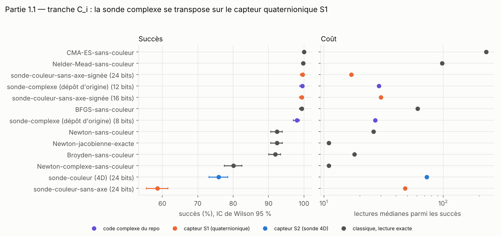
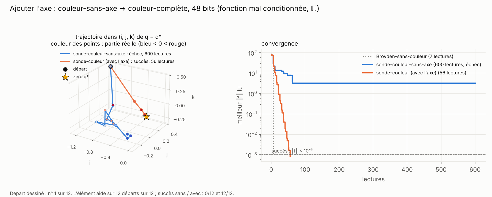
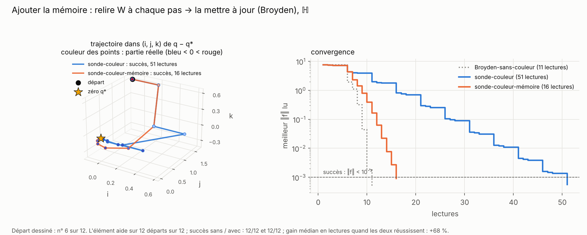
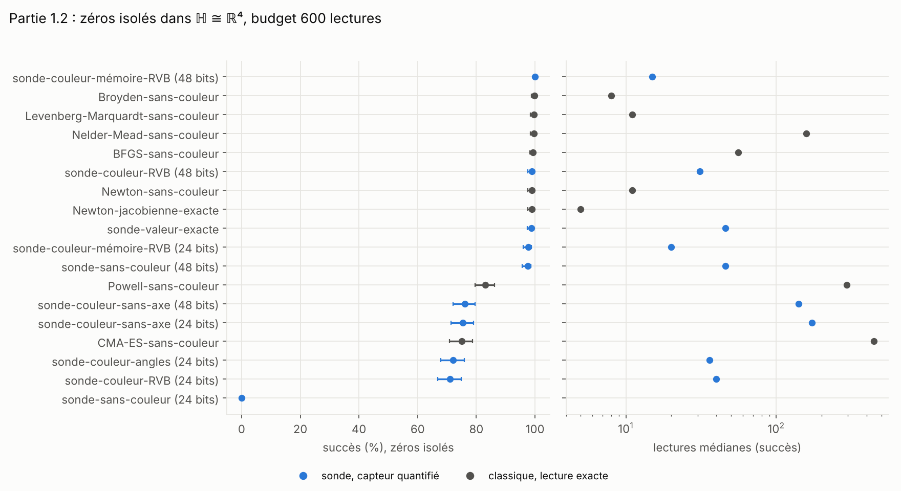
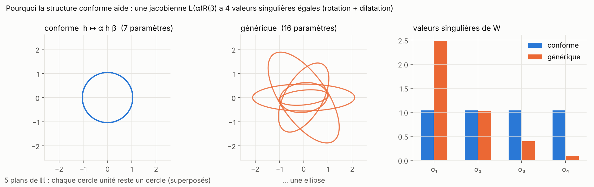
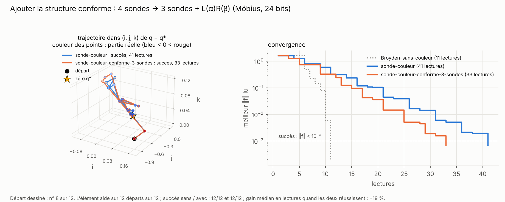
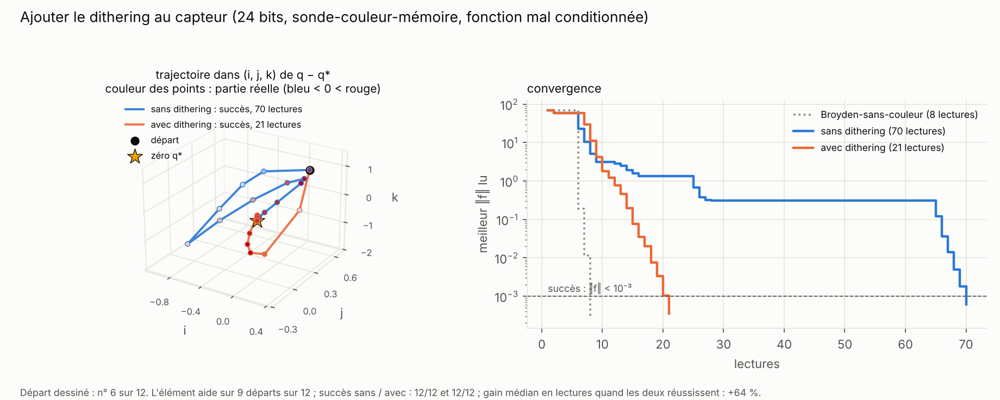
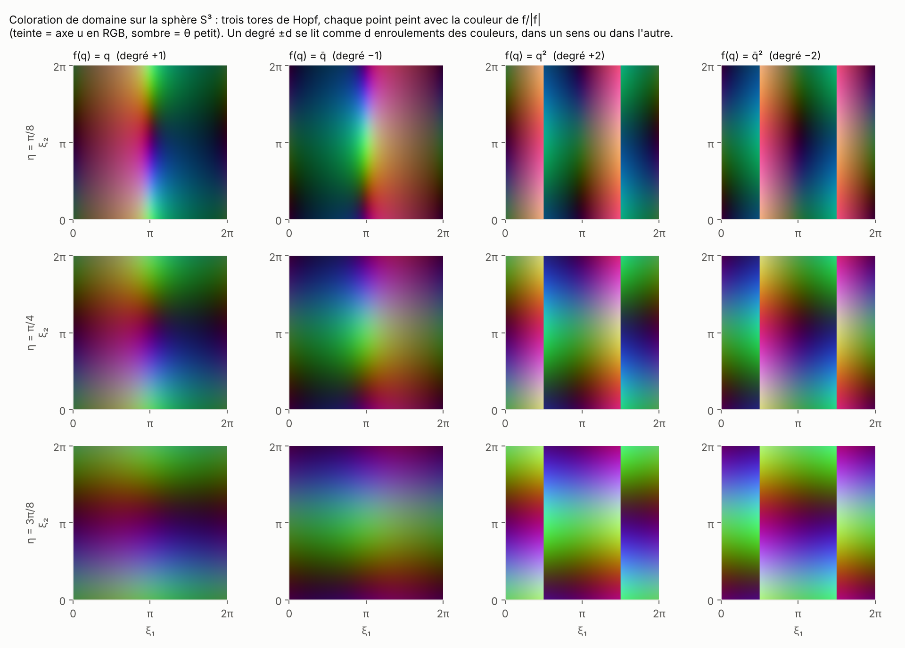

# Partie 1 : zéros des fonctions quaternioniques (dimension 4)

> **En bref.** On cherche un zéro de `f : ℍ → ℍ` en ne lisant que sa couleur. Sur une tranche ℂ ⊂ ℍ, la sonde retrouve exactement le comportement du dépôt complexe (100 % en 17 lectures). Sur une fonction quelconque, la meilleure sonde-couleur coûte environ **deux fois plus** que Broyden-sans-couleur. La structure conforme (Möbius) ne fait gagner qu'à bas débit et près du conforme, et parmi les améliorations testées seul le dithering aide (−10 à −12 % de lectures). En revanche, l'axe de la couleur donne quelque chose que Broyden n'a pas : un **certificat** topologique qu'il y a un zéro dans une boule (≈ 100 % avec 192 lectures, même bruité).

| section | question | verdict |
|---|---|---|
| [1.1 La tranche ℂ ⊂ ℍ](#11-la-tranche-ℂ--ℍ-test-de-cohérence) | la mécanique du complexe se transpose-t-elle ? | **oui** : 100 % en 17 lectures |
| [1.2 Fonctions quelconques](#12-fonctions-quelconques-ℍ--ℍ) | une sonde-couleur bat-elle Broyden en dimension 4 ? | **non** : 15 lectures contre 8 |
| [1.3 Structure conforme](#13-structure-conforme-möbius) | 7 paramètres au lieu de 16 font-ils gagner ? | **un peu** : −40 % à 24 bits si défaut ≤ 0,1, perdu à 36 bits |
| [1.4 Améliorations](#14-trois-idées-pour-améliorer-la-sonde) | dithering, démarrage conforme, région de confiance | **dithering seulement** |
| [1.5 Certificat de zéro](#15-certificat-de-zéro-le-degré-topologique-lu-dans-les-couleurs) | peut-on *prouver* qu'il y a un zéro ? | **oui** : ≈ 100 % avec 192 lectures |

Les sondes et les noms sont définis en [partie 0](../0_capteurs_et_sondes/README.md). Chaque fois qu'un élément s'ajoute à la sonde, une figure le montre **dans l'espace (i, j, k)** : la même descente sans puis avec l'élément, sur un départ où il aide, avec sous la figure le nombre de départs où il aide vraiment (script `schemas/make_ijk.py`).

## 1.1 La tranche ℂ ⊂ ℍ, test de cohérence

On restreint `f` à une copie du plan complexe dans ℍ (fonctions slice-régulières, `f(x + v) = A + (v/|v|)·B`). C'était le **critère d'arrêt** du plan d'étude : s'il échoue, on s'arrête. **Il passe.** 10 fonctions × 100 départs, budget 1 000 (`1.1_tranche/bench_tranches.py`).

| méthode | bits | lectures / pas | succès | lectures médianes |
|---|---|---|---|---|
| sonde-complexe (dépôt d'origine) | 24 | 2 | 98 % | 27 |
| **sonde-couleur-sans-axe-signée** | **24** | 2 | **100 %** | **17** |
| sonde-couleur-sans-axe (**non** signée) | 24 | 2 | 59 % | 48 |
| sonde-couleur (couleur-complète, 4D) | 24 | 5 | 76 % | 73 |
| Newton-jacobienne-exacte (4D) | — | 2 | 92 % | 11 |
| Broyden-sans-couleur (4D) | — | 1 (+5) | 92 % | 18 |
| Nelder-Mead-sans-couleur (4D) | — | 1 | 100 % | 98 |

- **Perdre le signe de l'angle coûte cher** : la couleur-sans-axe non signée confond `f` et `f̄` (59 %, 10 % sur `tanh`).
- Les zéros non réels sont des **sphères** (`q² + 1` s'annule sur toute la sphère `|Im q| = 1`) : des cibles plus grosses, d'où la préférence des arrivées pour elles ([figure](1.1_tranche/figures/03_spheres_de_zeros.png)).
- Sur la tranche l'axe n'apporte rien : la fonction y est complexe. Tableaux : [`bench_tranches_tables.md`](1.1_tranche/bench_tranches_tables.md).

## 1.2 Fonctions quelconques ℍ → ℍ

Hors des tranches, la jacobienne est une matrice 4×4 quelconque : 4 sondes (5 lectures) pour la lire. Sept familles (`lin`, `quad`, `cub`, `ill` mal conditionnée, zéros sur une courbe, une surface, pas de zéro), 3 instances × 40 départs, budget 600 (`1.2_fonctions_quelconques/bench_generique.py`).

| méthode | zéros isolés : succès | lectures médianes | famille `ill` |
|---|---|---|---|
| sonde-couleur, couleur-complète-RVB 48 bits | 99 % | 31 | 100 % |
| sonde-couleur-mémoire, couleur-complète-RVB 48 bits | 100 % | 15 | 100 % |
| sonde-couleur-mémoire, couleur-complète-RVB 24 bits | 98 % | 20 | 97 % |
| sonde-couleur-sans-axe (24 ou 48 bits) | 75 % | 141–172 | 2–9 % |
| sonde-sans-couleur, capteur-valeurs 48 bits | 98 % | 46 | 94 % |
| **Broyden-sans-couleur** | **100 %** | **8** | 100 % |
| Levenberg-Marquardt-sans-couleur | 100 % | 11 | 100 % |
| BFGS-sans-couleur | 99 % | 56 | 100 % |

**Premier élément : l'axe.** Sans axe, la couleur ne donne que 2 équations sur 4 : la sonde avance par projections successives et cale sur un problème mal conditionné. Avec l'axe, le quotient `ρ` est complet et le pas de Newton aussi.

**Deuxième élément : la mémoire.** Relire `W` à chaque pas coûte 5 lectures ; la mettre à jour par Broyden n'en coûte qu'une. La trajectoire est presque la même, le nombre de lectures est divisé par 3.

Le canal d'axe paie ses bits à partir de ~32 bits (`bench_bits.py`, succès / lectures médianes, même sonde) :

| bits | capteur-valeurs | couleur-sans-axe | couleur-complète-RVB | couleur-complète-angles |
|---|---|---|---|---|
| 16 | 0 % | 67 % / 162 | 10 % / 110 | 26 % / 118 |
| 24 | 0 % | 68 % / 165 | 64 % / 55 | 70 % / 48 |
| 36 | 66 % / 50 | 68 % / 158 | 92 % / 46 | 99 % / 46 |
| 48 | 96 % / 46 | 68 % / 162 | 99 % / 46 | 99 % / 46 |

- **Les sondes-couleur coûtent environ deux fois plus que Broyden-sans-couleur**, même avec la mémoire.
- Le capteur-valeurs exige beaucoup de bits (0 % à 24 bits) ; l'axe en deux angles bat l'axe en RVB.
- Tableaux : [`bench_generique_tables.md`](1.2_fonctions_quelconques/bench_generique_tables.md), [`bench_bits_tables.md`](1.2_fonctions_quelconques/bench_bits_tables.md).

## 1.3 Structure conforme (Möbius)

Pour une Möbius `f(q) = (aq + b)(cq + d)⁻¹`, la jacobienne vaut `L(α)R(β)` : **7 paramètres** au lieu de 16, donc 3 sondes suffisent. On dégrade ensuite `f` vers une fonction quelconque (`f_ε = M + ε·G(q − q*)`) et on suit le défaut de conformité. 5 instances × 30 départs, comparaisons appariées (`1.3_structure_conforme/bench_mobius.py`).

Succès % / lectures médianes, 24 bits :

| méthode | défaut 0 | 0,07 | 0,20 | 0,50 | 0,61 |
|---|---|---|---|---|---|
| sonde-couleur | 100 / 45 | 99 / 45 | 97 / 49 | 49 / 76 | 37 / 143 |
| sonde-couleur-conforme-3-sondes | 100 / **28** | 100 / **28** | 100 / 40 | 82 / 233 | 36 / 404 |
| sonde-couleur-mémoire | 100 / 18 | 100 / 18 | 100 / 18 | 83 / 24 | 99 / 32 |
| sonde-couleur-mémoire-conforme | 100 / 17 | 100 / 18 | 100 / 18 | 82 / 49 | 47 / 130 |
| Broyden-sans-couleur | 100 / 13 | 100 / 14 | 99 / 15 | 74 / 20 | 100 / 19 |

**Troisième élément : la structure conforme.** Sur une Möbius exacte à 24 bits, la sonde à 3 sondes fait des pas aussi bons pour une lecture de moins par pas : la contrainte conforme moyenne aussi l'erreur de quantification.

- Gain apparié de la sonde-couleur-conforme-3-sondes sur la sonde-couleur : **+41 %** [40, 42] à 24 bits, défaut 0 ; **−60 %** à 36 bits. Ce n'est donc pas un effet de structure seul : à 24 bits la contrainte corrige la quantification.
- L'avantage disparaît vers un défaut de 0,2, puis devient une grosse perte. La version à mémoire ne gagne que 3 à 7 %. Tableaux : [`bench_mobius_tables.md`](1.3_structure_conforme/bench_mobius_tables.md), [gains appariés](1.3_structure_conforme/figures/02_gain_apparie.png).

## 1.4 Trois idées pour améliorer la sonde

Cadre « armes égales » (partie 5) : Broyden lit la même mesure dégradée. Gain apparié contre la sonde-couleur-mémoire de base, 3 instances × 30 départs (`1.4_ameliorations/bench_ameliorations.py`) :

| variante | 24 bits, `σ = 0` | 24 bits, `σ = 0,02` | 36 bits, `σ = 0` | 36 bits, `σ = 0,02` |
|---|---|---|---|---|
| **dithering** (décalage connu avant quantification) | **+10** [+6, +15] | −2 [−7, +3] | **+12** [+10, +15] | **+11** [+8, +14] |
| démarrage conforme (3 sondes + projection) | −27 | −45 | −51 | −18 |
| région de confiance pilotée par la luminosité | −7 | −18 | −25 | +10 |

**Quatrième élément : le dithering.** Sans dithering, deux lectures voisines tombent dans la même case et leurs erreurs de quantification, déterministes, s'additionnent dans la mise à jour de la mémoire ; le dithering les rend indépendantes. Sur une fonction mal conditionnée à 24 bits, la descente cesse de tourner en rond.

- Le biais du quotient tombe de 0,026 à 0,0007. Mais à 36 bits sans bruit le dithering fait chuter le succès de 97 % à 81 %, ce qui n'est pas expliqué.
- Sur des fonctions faciles, il ne change presque rien (mêmes lectures à une près) ; la figure le montre là où il compte.
- Démarrage conforme et région de confiance font perdre ([fausses pistes](../../fausses-pistes/README.md)). Face à Broyden-mêmes-mesures, avec dithering : −23 %, +21 %, −9 %, −21 %. Tableaux : [`bench_ameliorations_tables.md`](1.4_ameliorations/bench_ameliorations_tables.md).

## 1.5 Certificat de zéro, le degré topologique lu dans les couleurs

Pour un zéro isolé, `f/|f|` envoie une petite sphère S³ sur S³ avec un degré entier ; un degré non nul **prouve** qu'il y a un zéro dans la boule. On le lit avec la seule direction de `f` (angle + axe), aux sommets d'une triangulation de S³ (16 tétraèdres raffinés par Bey ; profondeur 2 = 192 sommets), en comptant avec leur signe les tétraèdres dont l'image couvre une direction cible (`src/degree.py`).

| profondeur | lectures | degré exact, sans bruit (12–48 bits) | sur `q³` |
|---|---|---|---|
| 1 | 32 | ≈ 78–83 % | 0–8 % |
| 2 | 192 | **100 %** (≥ 99 % dès 16 bits) | 92–100 % |

- Avec bruit (48 bits) : 100 % à `σ = 0,1`, 99 % à `σ = 0,2`. Classification « zéro dans la boule ? » parfaite à profondeur 2. Sur `q̄²` (zéro double), le certificat lit −2 à chaque fois.
- C'est un **certificat**, pas un concurrent de Broyden (192 lectures). La couleur-sans-axe en est exclue par construction. Il sert en partie 6.1 à certifier les points fixes d'un RNN.
- La méthode ne passera pas à l'échelle en ℍⁿ (triangulation de S^(4n−1)). Tableaux : [`bench_degre_tables.md`](1.5_certificat_degre/bench_degre_tables.md).

Code : `src/probes.py` (sondes), `src/degree.py`, un dossier par section avec `bench_*.py`, `*_results.json`, `*_tables.md` et `figures/`.
