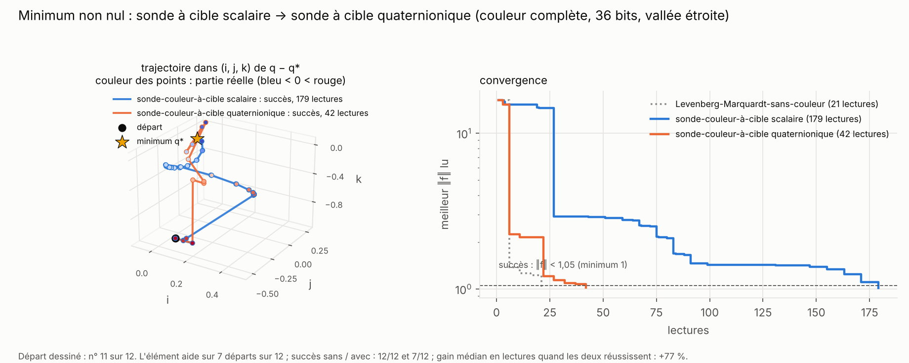
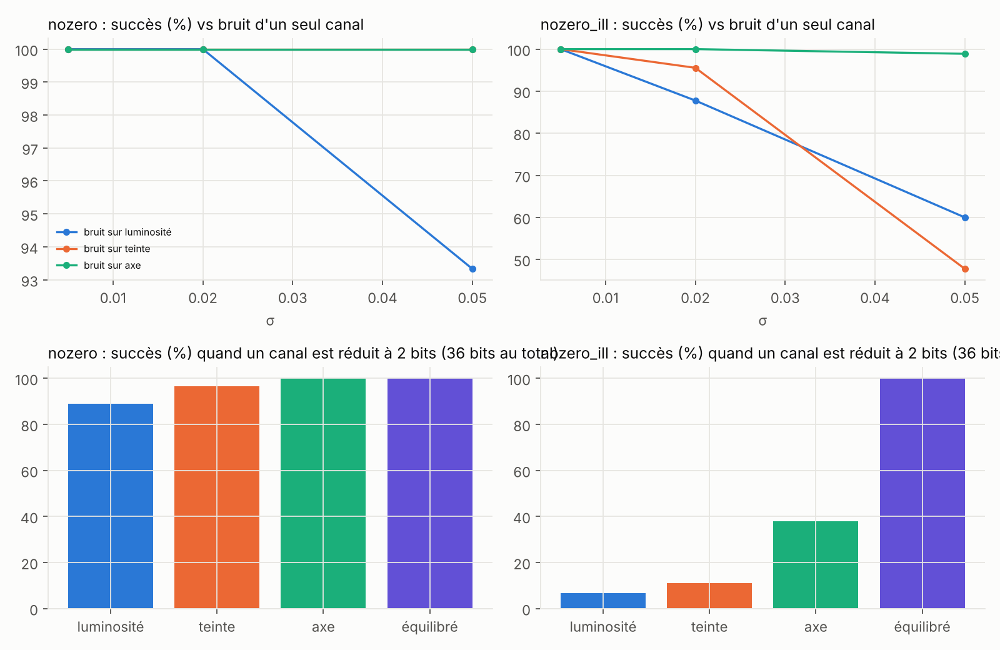

# Partie 2 : minimums des fonctions quaternioniques

> **En bref.** Quand `f` n'a pas de zéro, on minimise `|f|²` ; près du minimum la luminosité s'aplatit et la sonde de base n'a plus de signal. La sonde à cible du dépôt complexe (lire `l − m₀` avec `m₀` un peu sous la perte) fait jeu égal avec BFGS-sans-couleur sur un cas facile et perd en vallée étroite. Une **sonde-couleur-à-cible quaternionique**, qui lit la couleur complète (luminosité, angle, axe), fait mieux : 11 et 30 lectures, devant BFGS-sans-couleur, derrière Levenberg-Marquardt-sans-couleur. Mais ce gain suppose `|f|` connu au point courant : **sans cette information, il disparaît**. L'ablation montre que l'axe n'est pas inutile, et que c'est le canal qui supporte le mieux le bruit.

## 2.1 Sonde à cible scalaire (dépôt complexe)

Banc : `bench_minimum.py`. Familles sans zéro, `nozero` (conditionnement 3) et `nozero_ill` (100), succès si `|f| < 1,05` (minimum 1). 3 instances × 30 départs.

| méthode | `nozero` | `nozero_ill` |
|---|---|---|
| sonde-couleur-à-cible scalaire, 24 bits (= 36 bits) | 100 % / 42 | 100 % / 186 |
| BFGS-sans-couleur | 100 % / 41 | 100 % / 56 |
| **Levenberg-Marquardt-sans-couleur** | 100 % / **17** | 100 % / **17** |
| Nelder-Mead-sans-couleur | 100 % / 36 | 100 % / 128 |
| CMA-ES-sans-couleur | 100 % / 104 | 100 % / 314 |

## 2.2 Sonde à cible quaternionique et ablation des canaux

Banc : `bench_ablation.py`. L'instrument rend `F̃ = R·(|R| − m₀)/|R|` ; sa couleur complète donne `W` en 4 sondes, puis un pas de Levenberg-Marquardt `h = −(WᵀW + μI)⁻¹Wᵀe₀`. Ablation à 36 bits : un canal réduit à 2 bits, ou un bruit sur un seul canal.

**L'élément ajouté : la cible quaternionique.** La sonde du dépôt complexe ne lit que la luminosité d'un scalaire, `‖f‖² − m₀` ; la sonde-couleur-à-cible quaternionique lit la couleur complète de `F̃`, donc une direction de descente entière à chaque quotient. En vallée étroite, la première avance par petits pas le long du fond ; la seconde y descend directement.

*Le pas de sonde est fixé à `η = 0,1` dans la figure (non réglé), d'où 7 succès sur 12 au lieu des 100 % du tableau, où `η` est choisi parmi trois valeurs.*

| cas | `nozero` | `nozero_ill` |
|---|---|---|
| couleur-complète 36 bits, équilibrée (9/9/9/9) | 100 % / **11** | 100 % / **30** |
| couleur-complète 24 bits | 100 % / 21 | 88 % / 58 |
| luminosité réduite à 2 bits | 89 % / 16 | **7 %** |
| angle réduit à 2 bits | 97 % / 16 | **11 %** |
| axe réduit à 2 bits | 100 % / 16 | **38 %** |
| bruit `σ = 0,05` sur la luminosité | 93 % / 16 | 60 % / 48 |
| bruit `σ = 0,05` sur l'angle | 100 % / 21 | 48 % / 47 |
| bruit `σ = 0,05` sur l'axe | 100 % / 26 | **99 %** / 60 |

## 2.3 Sans connaître `|f|` au point courant

Banc : `bench_suivi.py` (de cette partie). Les sondes 2.1 et 2.2 supposent `|f|` connu au point courant pour fixer `m₀`. Si on ne donne que l'échelle de départ et qu'on suit `|f|` par les quotients :

| | `nozero` | `nozero_ill` |
|---|---|---|
| 24 bits | 90 % / 50 | 36 % / 163 |
| 36 bits | 91 % / 50 | 57 % / 172 |
| 36 bits, bruit 0,02 | 90 % / 52 | 34 % / 185 |

## 2.4 Ce que l'on voit

- Les trois canaux comptent ; la luminosité et l'angle sont les plus critiques pour la précision, **l'axe est le mieux supporté face au bruit**.
- La sonde-couleur-à-cible quaternionique bat BFGS-sans-couleur (11 contre 41 ; 30 contre 56) mais pas Levenberg-Marquardt-sans-couleur (17).
- **Sans `|f|` au point courant, l'avantage disparaît** : l'estimation dérive (elle suppose `|f| − m₀` positif).
- Cette partie reste en dimension 4. En ℍⁿ, la partie 6 entraîne des neurones et des couches sur des problèmes carrés (zéro exact) ; le cas des moindres carrés à minimum non nul n'est pas traité, et la condition « `|f|` connu au point courant » y serait le verrou.

Détails : [`bench_minimum_tables.md`](bench_minimum_tables.md), [`bench_ablation_tables.md`](bench_ablation_tables.md).
