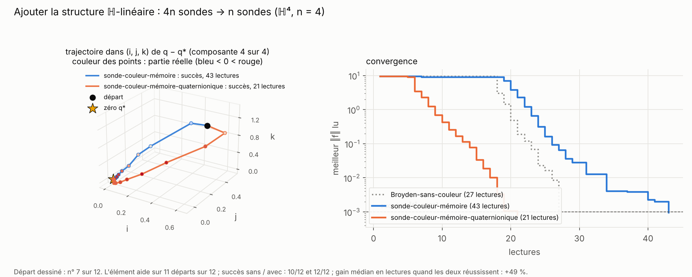
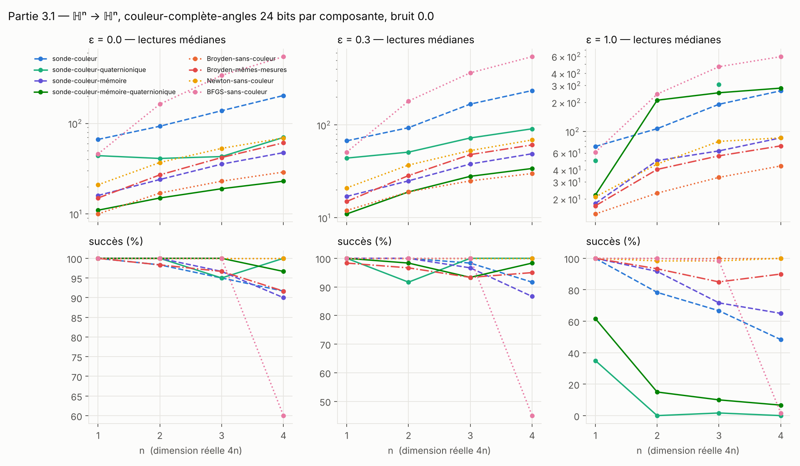
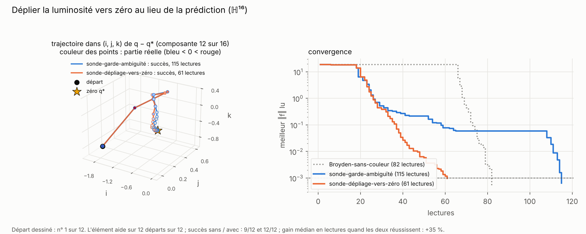
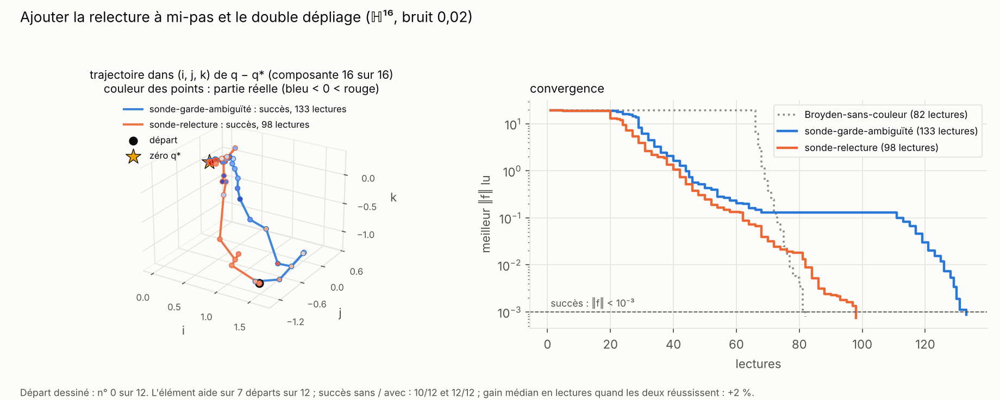
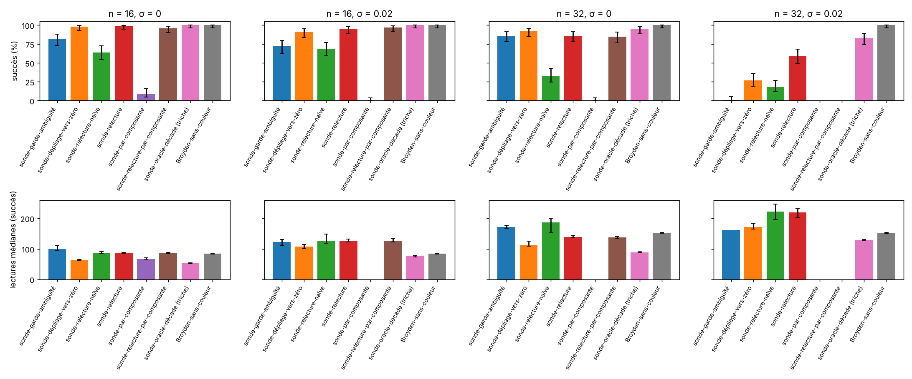
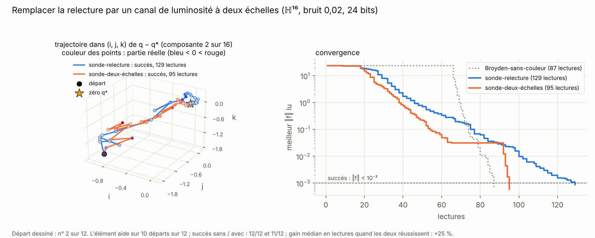
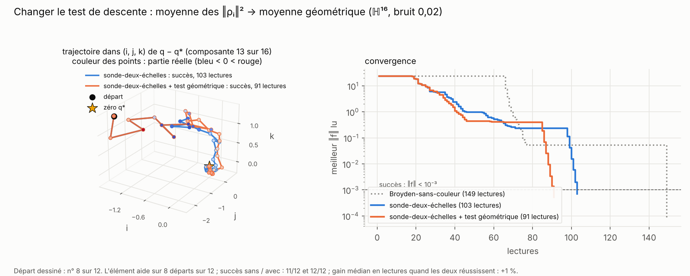
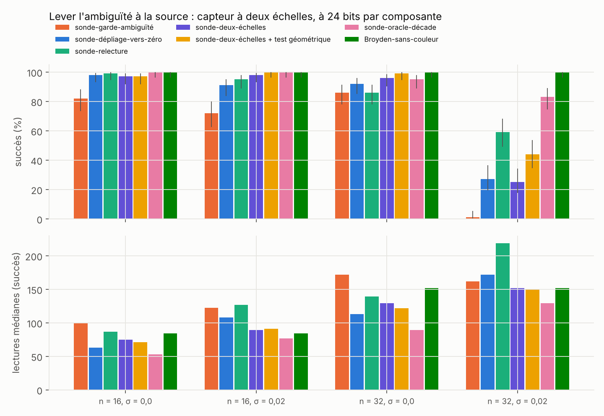

# Partie 3 : dimension 4n, ℍⁿ → ℍⁿ

> **En bref.** En dimension 4, la jacobienne n'a que 16 paramètres et Broyden s'en sort avec très peu de lectures (partie 1). En ℍⁿ (dimension réelle 4n), elle en a 16n². Si elle est **ℍ-linéaire** (`h ↦ A·h`, `A` matrice de quaternions), elle n'en a plus que 4n², et l'axe de la couleur permet de la lire avec **n sondes au lieu de 4n**. La sonde-couleur-mémoire-quaternionique bat alors Broyden-sans-couleur, qui ignore la structure (−15 à −17 % de lectures à n = 3–4). L'avantage **plafonne vers n = 8 et s'inverse ensuite** ; la cause est l'**ambiguïté de la luminosité** (la dent de scie). La relecture à mi-pas (3.4) rend la sonde fiable avec bruit, mais coûte des lectures. **Un capteur à deux échelles (3.5), à bits égaux, supprime l'ambiguïté** : avec un test de descente géométrique, la sonde rebat Broyden-sans-couleur sans bruit jusqu'à n = 32 (122 lectures contre 152) ; avec bruit à n = 32, la couleur plus grossière ne suffit plus.
>
> La structure ne demande pas la couleur : un Broyden quaternionique qui lit la valeur exacte et connaît la même structure coûte 14, 23, 34 et 53 lectures à n = 4, 8, 16 et 32, moins que toutes les sondes (partie [5.5](../5_armes_egales/README.md#55-même-structure-pour-tous--la-référence-qui-manquait)). Ce que montre cette partie, c'est que **la couleur suffit** pour exploiter la structure, et ce qui la limite en grande dimension.

Dans tout le rapport, **n est le nombre de quaternions** et la dimension réelle est 4n.

| section | question | verdict |
|---|---|---|
| [3.1 Jacobienne ℍ-linéaire](#31-jacobienne-ℍ-linéaire-n--1-à-4) | la structure fait-elle gagner, n = 1 à 4 ? | **oui** : 23 lectures contre 29 pour Broyden-sans-couleur à n = 4 |
| [3.2 Grande dimension](#32-grande-dimension-n--8-16-32) | et à n = 8, 16, 32 ? | **l'avantage plafonne puis s'inverse** |
| [3.3 Pourquoi ça décroche](#33-pourquoi-la-sonde-décroche) | quelle est la cause ? | **l'ambiguïté de la luminosité** |
| [3.4 Lever l'ambiguïté sans oracle](#34-lever-lambiguïté-sans-oracle--la-relecture) | un remède sans oracle rejoint-il l'oracle ? | **non** : la relecture est fiable mais chère |
| [3.5 Deux échelles et test de descente](#35-lever-lambiguïté-à-la-source-et-le-test-de-descente) | capteur à deux échelles, relecture économe, vote, test de descente | **le capteur à deux échelles supprime l'ambiguïté** ; sans bruit, la sonde rebat Broyden à n = 32 ; le test de descente refuse surtout de vrais mauvais pas |

## 3.1 Jacobienne ℍ-linéaire, n = 1 à 4

Une lecture de `f` donne **n couleurs** (une par composante, 24 bits chacune). Pour chaque composante, `ρᵢ = Fᵢ(q)⁻¹Fᵢ(q + h) = 1 + (W h)ᵢ` avec `W = diag(F)⁻¹J`, et l'équation de Newton devient **`W h = −𝟙`** (le quaternion 1 dans chaque bloc). Un pas est accepté si la moyenne des `‖ρᵢ‖²` baisse.

| nom | comment `W` est obtenue | lectures par jacobienne |
|---|---|---|
| sonde-couleur | 4n sondes, `W` réelle 4n × 4n | 4n + 1 |
| sonde-couleur-quaternionique | n sondes (direction 1 dans chaque bloc), bloc `(i, j) = L(wᵢⱼ)` | n + 1 |
| sonde-couleur-mémoire | Broyden réel | 1 par pas |
| **sonde-couleur-mémoire-quaternionique** | mise à jour de Broyden quaternionique `wᵢⱼ ← wᵢⱼ + (dᵢ − (Wh)ᵢ)·h̄ⱼ / ‖h‖²`, qui garde la structure | 1 par pas |

Banc (`3.1_jacobienne_H_lineaire/bench_hn.py`) : `f(d) = A·d·(1 + |dⱼ|²/2) + ε·G·d`, `A` quaternionique, `G` réelle ; ε = 0 presque ℍ-linéaire, ε = 1 quelconque. 3 instances × 20 départs, budget 600. Lectures médianes, sans bruit :

| ε | méthode | n = 1 | n = 2 | n = 3 | n = 4 |
|---|---|---|---|---|---|
| 0 | sonde-couleur-mémoire | 16 | 24 | 36 | 48 |
| 0 | **sonde-couleur-mémoire-quaternionique** | 11 | **15** | **19** | **23** |
| 0 | Broyden-sans-couleur | 10 | 17 | 23 | 29 |
| 0 | Broyden-mêmes-mesures | 15 | 27 | 42 | 61 |
| 0,3 | sonde-couleur-mémoire-quaternionique | 11 | 19 | 28 | 34 |
| 0,3 | Broyden-sans-couleur | 12 | 19 | 25 | 30 |
| 1 | sonde-couleur-mémoire-quaternionique | 22 (62 %) | 211 (15 %) | 252 (10 %) | 282 (7 %) |

**L'élément ajouté : la structure ℍ-linéaire.** Avec l'axe, une sonde dans la direction 1 d'un bloc donne d'un coup un coefficient quaternionique entier de la jacobienne. La sonde lit 4 fois moins de paramètres, et sa mémoire garde la structure : les pas sont plus directs dès le début.

- Gain apparié sur **Broyden-sans-couleur**, ε = 0 : −4 % [−6, −3] à n = 1, +6 % à n = 2, **+15 %** [+13, +17] à n = 3, **+17 %** [+13, +21] à n = 4. Sur Broyden-mêmes-mesures : +35 à +59 %.
- **Le revers est brutal** : dès ε = 0,3, l'avantage disparaît à n = 3 ; à ε = 1, la sonde structurée échoue presque toujours.
- Avec bruit `σ = 0,02` : jeu égal avec Broyden-sans-couleur (−8 à 0 %). Tableaux : [`bench_hn_tables.md`](3.1_jacobienne_H_lineaire/bench_hn_tables.md).

## 3.2 Grande dimension, n = 8, 16, 32

Même famille, version vectorisée (`3.2_grande_dimension/bench_hn_grand.py`), budget 2000, 30 départs par case. Succès % / lectures médianes :

| n | ε | σ | sonde-couleur-mémoire | sonde-couleur-mémoire-quaternionique | Broyden-sans-couleur | Broyden-mêmes-mesures |
|---|---|---|---|---|---|---|
| 8 | 0 | 0 | 47 % / 159 | **90 % / 47** | 100 % / 49 | 73 % / 138 |
| 16 | 0 | 0 | 63 % / 220 | 83 % / 97 | 100 % / 84 | 43 % / 491 |
| 16 | 0 | 0,02 | 7 % / 274 | 77 % / 123 | 100 % / 84 | 0 % |
| 32 | 0 | 0 | 17 % / 375 | 63 % / 167 | 100 % / 151 | 0 % |
| 32 | 0 | 0,02 | 0 % | 7 % / 171 | 100 % / 151 | 0 % |
| 32 | 0,3 | 0 | 20 % / 392 | 70 % / 181 | 100 % / 154 | 0 % |

- **L'avantage plafonne vers n = 8 et s'inverse au-delà** ; avec bruit, la sonde s'effondre à n = 32 (7 %).
- Face à ce qui n'a pas la structure, elle reste très devant : la sonde sans structure et Broyden-mêmes-mesures tombent à 0–17 % à n = 32. Journal complet : `bench_hn_grand.log`.

## 3.3 Pourquoi la sonde décroche

**Le mécanisme.** La luminosité ne donne `log‖F‖` qu'à une décade près. Pour comparer deux lectures, la sonde déplie la variation de luminosité au plus près de ce que prédit son modèle `W` ; si la lecture s'en écarte de plus de 0,4 décade, la composante est **ambiguë**. En dimension 4n, **une seule composante ambiguë sur n fait rejeter tout le pas**, et la lecture est perdue.

`3.3_decrochage/diag11.py` est une copie instrumentée de la sonde, et des variantes lèvent **une cause à la fois** ; une **sonde-oracle** triche (elle utilise la vraie fonction) et ne sert qu'à mesurer ce qu'on gagnerait. 12 départs par case, ε = 0 :

| n | σ | sonde-couleur-mémoire-quaternionique | sonde-oracle-luminosité | **sonde-oracle-décade** | sonde-dépliage-vers-zéro | sonde-sans-drapeau | sonde-oracle-jacobienne |
|---|---|---|---|---|---|---|---|
| 16 | 0 | 83 % / 102 | 100 % / 52 | 100 % / 53,5 | 100 % / 63,5 | 8 % / 62 | 100 % / 28 |
| 32 | 0 | 58 % / 156 | 100 % / 80 | 100 % / 88,5 | 100 % / 125,5 | 8 % / 98 | 100 % / 45 |
| 32 | 0,02 | **8 %** / 162 | 100 % / 122,5 | 75 % / 133 | 17 % / 199 | 0 % | 100 % / 45 |

1. **L'ambiguïté est la cause principale.** Elle fait rejeter 5 % des lectures de pas à n = 4, 25 % à n = 8, 45 % à n = 32. L'oracle de décade, qui garde bruit et quantification, ramène la sonde à 100 % à n = 32 sans bruit.
2. **Elle vient d'une prédiction fausse, pas de la taille du pas** : le modèle `W` a une erreur relative de 150–250 % même quand la sonde réussit, et réduire le pas ne change presque rien.
3. **Les ambiguïtés sont corrélées entre composantes** : on attendrait 60–70 % de pas rejetés si elles étaient indépendantes, on en mesure 25–45 %.
4. **Amortir la mise à jour de la mémoire est une fausse piste** ; ignorer le drapeau aussi (0 à 8 %) : une décade fausse empoisonne la mémoire.

**L'élément ajouté : déplier vers zéro.** Puisque la prédiction du modèle est fausse, la sonde-dépliage-vers-zéro déplie la luminosité au plus près de 0 (pas de variation), le bon a priori pour un petit pas. Les pas cessent d'être rejetés pour ambiguïté.

Limites : 12 départs par case (repris sur 100 départs en 3.4), une famille, ε = 0. Journaux : `diag_*.log`.

## 3.4 Lever l'ambiguïté sans oracle : la relecture

**La sonde-relecture.** Après la lecture en `q + h`, une composante est **douteuse** si sa variation dépliée s'écarte de plus de τ = 0,25 décade de la prédiction, ou si le dépliage vers la prédiction et le dépliage vers 0 ne tombent pas sur la même décade (**double dépliage**). On relit alors **une fois** en `q + h/2` (une lecture couvre les n composantes) ; sur ce petit pas on déplie vers 0, on en déduit une prédiction fraîche du grand pas, `ln‖1 + 2(ρˢ − 1)‖`, et on redéplie les composantes douteuses autour. Réglage (k = 2, τ = 0,25) choisi sur des graines de calibration jamais réutilisées (`3.4_ambiguite/sonde34.py`, `bench34.py`).

Succès [IC 95 %] / lectures médianes, **100 départs par case** (graines 100–109 × 10), budget 2000 :

| méthode | n = 16, σ = 0 | n = 16, σ = 0,02 | n = 32, σ = 0 | n = 32, σ = 0,02 |
|---|---|---|---|---|
| sonde-garde-ambiguïté | 82 % [73 ; 88] / 100 | 72 % [63 ; 80] / 122 | 86 % [78 ; 91] / 172 | 1 % [0 ; 5] / 162 |
| sonde-dépliage-vers-zéro | 98 % [93 ; 99] / **63** | 91 % [84 ; 95] / 108 | **92 %** [85 ; 96] / **113** | 27 % [19 ; 36] / 172 |
| sonde-relecture-naïve (sans double dépliage) | 64 % / 87 | 69 % / 126 | 33 % / 186 | 18 % / 222 |
| **sonde-relecture** | **99 %** [95 ; 100] / 87 | **95 %** [89 ; 98] / 127 | 86 % [78 ; 91] / 139 | **59 %** [49 ; 68] / 219 |
| sonde-par-composante | 9 % / 66 | 0 % | 0 % | non lancée |
| *sonde-oracle-décade (triche)* | 100 % / 53 | 100 % / 77 | 95 % / 89 | 83 % / 129 |
| *Broyden-sans-couleur (lit F exactement)* | 100 % / 84 | 100 % / 84 | 100 % / 152 | 100 % / 152 |

**L'élément ajouté : la relecture.** Avec bruit, la sonde qui garde l'ambiguïté voit ses pas rejetés les uns après les autres ; une relecture à mi-pas lève le doute, et la descente reprend.

1. **Avec bruit, la relecture est le seul remède qui passe 50 % à n = 32** (59 % contre 27 % et 1 %). Elle coûte une relecture sur 82–90 % des pas sans bruit ; **sans bruit, le dépliage vers zéro reste meilleur** (113 lectures contre 139).
2. **Le double dépliage est indispensable** : sans lui, 8,9 % des pas acceptés portent une **décade fausse muette** (une erreur de plus de 0,5 décade qui se replie sans drapeau), contre 0,5 %.
3. **La mise à jour composante par composante échoue** (0 à 9 %) : elle laisse entrer les décades fausses muettes.
4. **Avec bruit, le verrou devient le test de descente** : à n = 32 et σ = 0,02, 79 % des lectures de pas sont refusées par le test de descente, même pour l'oracle. C'est la question de la section 3.5.

Tableaux complets (calibration, écarts appariés à l'oracle, décades fausses muettes) : [`bench34_tables.md`](3.4_ambiguite/bench34_tables.md).

## 3.5 Lever l'ambiguïté à la source, et le test de descente

Suite de 3.4. Mêmes problèmes, mêmes 100 départs, mêmes capteurs qu'en 3.4 ; les méthodes de la 3.4 ne sont pas relancées (la sonde générale `src/sonde_hn.py` les reproduit à la lecture près, et la sonde-oracle-décade relancée retrouve exactement 100 % / 53 et 95 % / 89). Nouvelles pistes (`3.5_deux_echelles/bench35.py`) :

| nom | ce qu'il fait |
|---|---|
| sonde-relecture-économe | ne relit que si le double dépliage est en désaccord, pas sur le seul écart à la prédiction |
| sonde-vote | les ambiguïtés sont corrélées (3.3) : on corrige les composantes douteuses par le décalage médian des composantes sûres |
| **sonde-deux-échelles** | **capteur à deux échelles, à bits égaux** : 4 des 24 bits lisent une luminosité grossière sur 10 décades, la décade est lue directement (luminosité fine, angle et axe passent de 6 à 5 bits) |
| … + test géométrique | test de descente sur la moyenne des `ln‖ρᵢ‖` au lieu de la moyenne des `‖ρᵢ‖²` : une composante qui remonte pèse moins |
| … + test pondéré | test sur `Σ mᵢ²‖ρᵢ‖² / Σ mᵢ²`, `mᵢ = ‖Fᵢ‖` suivi par les luminosités : la vraie perte `‖F‖²` |

Diagnostic (vraie fonction, sans effet sur l'algorithme) : un refus **à tort** est un pas refusé par le test alors que la vraie moyenne des `‖ρᵢ‖²` passait.

Succès [IC 95 %] / lectures médianes, 100 départs par case :

| méthode | n = 16, σ = 0 | n = 16, σ = 0,02 | n = 32, σ = 0 | n = 32, σ = 0,02 |
|---|---|---|---|---|
| sonde-garde-ambiguïté (3.4) | 82 % / 100 | 72 % / 122 | 86 % / 172 | 1 % / 162 |
| sonde-dépliage-vers-zéro (3.4) | 98 % / **63** | 91 % / 108 | 92 % / **113** | 27 % / 172 |
| sonde-relecture (3.4) | 99 % / 87 | 95 % / 127 | 86 % / 139 | **59 %** / 219 |
| sonde-relecture-économe | 99 % / 84 | 91 % / 119 | — | — |
| sonde-vote | 22 % / 82 | 5 % / 77 | — | — |
| **sonde-deux-échelles** | 97 % [92 ; 99] / 75 | **98 %** [93 ; 99] / **89** | 96 % [90 ; 98] / 130 | 25 % [18 ; 34] / 152 |
| **sonde-deux-échelles + test géométrique** | 97 % / 71 | **100 %** / 91 | **99 %** [95 ; 100] / 122 | 44 % [35 ; 54] / 150 |
| sonde-deux-échelles + test pondéré | 100 % / 72 | 99 % / 84 | 100 % / 125 | non lancée |
| *sonde-oracle-décade (triche)* | 100 % / 53 | 100 % / 77 | 95 % / 89 | 83 % / 129 |
| *sonde-oracle-décade + test géométrique* | 100 % / 52 | 100 % / 76 | 92 % / 86 | non lancée |
| *Broyden-sans-couleur* | 100 % / 84 | 100 % / 84 | 100 % / 152 | 100 % / 152 |

**L'élément ajouté : la luminosité à deux échelles.** La relecture vérifie la décade après coup ; le capteur à deux échelles la lit. Plus aucun pas n'est rejeté pour ambiguïté, et la sonde ne paie plus de relectures.

**L'élément ajouté ensuite : le test géométrique.** Avec la moyenne des `‖ρᵢ‖²`, une seule composante qui remonte peut faire refuser un pas qui fait baisser presque toutes les autres ; la moyenne des logarithmes le pèse moins.

1. **Le vote échoue** (22 % puis 5 %) : le décalage commun existe, mais il ne vaut pas une décade entière, et redéplier autour de lui fait passer des décades fausses pour sûres ([fausses pistes](../../fausses-pistes/README.md)).
2. **La relecture économe** économise 3 % de lectures sans bruit [+2 ; +6], rien de significatif avec bruit, et perd 4 points de succès : le gain est marginal.
3. **Le capteur à deux échelles supprime l'ambiguïté à bits égaux.** Avec bruit à n = 16, il bat la relecture de 30 % en lectures appariées [+27 ; +35] avec plus de succès (98 % contre 95 %). Sans bruit, il reste plus cher que le dépliage vers zéro (−17 à −19 %) : il paie la décade avec la précision de la couleur.
4. **Avec le test géométrique, la sonde-couleur rebat Broyden-sans-couleur en grande dimension** sans bruit : +15 % [+12 ; +18] à n = 16, **+19 %** [+17 ; +22] à n = 32 (99 % de succès, 122 lectures contre 152), alors que la partie 3.2 montrait un avantage inversé dès n = 16. Avec bruit à n = 16, elle reste un peu derrière (−8 % [−12 ; −1]).
5. **Avec bruit à n = 32, les deux échelles ne suffisent pas** (25 % de succès) : 97 % des pas sont refusés par le test de descente, et pas à tort. Les 5 bits de couleur fine au lieu de 6, plus le bruit, rendent la mémoire `W` trop fausse : on échange l'ambiguïté contre de l'imprécision. Le test géométrique remonte le succès à 44 %, sans rejoindre la relecture (59 %) ; même l'oracle de décade plafonne à 83 %, avec 79 % de pas refusés, dont 1 % à tort.
6. **Le test de descente refuse surtout des pas vraiment mauvais.** Les refus à tort ne pèsent que 0 à 13 % des refus, pour toutes les méthodes (tableau dans [`bench35_tables.md`](3.5_deux_echelles/bench35_tables.md)). Le test géométrique baisse la part des refus (0,44 → 0,34 à n = 16 ; 0,25 → 0,15 pour l'oracle à n = 32) et fait gagner jusqu'à 5 % de lectures (−2 à +5 % selon la case). La réponse à la question de la 3.4 est donc : la moyenne des `‖ρᵢ‖²` est un critère raisonnable ; le verrou avec bruit est la qualité de `W`, pas le critère d'acceptation.

Limites : une famille, ε = 0 ; le capteur à deux échelles n'a qu'une répartition des bits (4 grossiers, 5 fins) ; à n = 32 avec bruit, le test pondéré et l'oracle géométrique n'ont pas été lancés faute de temps de calcul (chaque case y prend plus d'une heure sur 2 cœurs).

## Fichiers

`3.1_jacobienne_H_lineaire/` (`bench_hn.py`, `probe_hn`), `3.2_grande_dimension/` (`bench_hn_grand.py`), `3.3_decrochage/` (`diag11.py`, `run_diag.py`, journaux), `3.4_ambiguite/` (`sonde34.py`, `bench34.py`, calibration et banc final), `3.5_deux_echelles/` (`bench35.py` ; la sonde est `src/sonde_hn.py`, vérifiée identique à `sonde34.py` par `tests/test_sonde_hn.py`). La comparaison avec Broyden qui lit les mêmes mesures est regroupée en [partie 5](../5_armes_egales/README.md).
