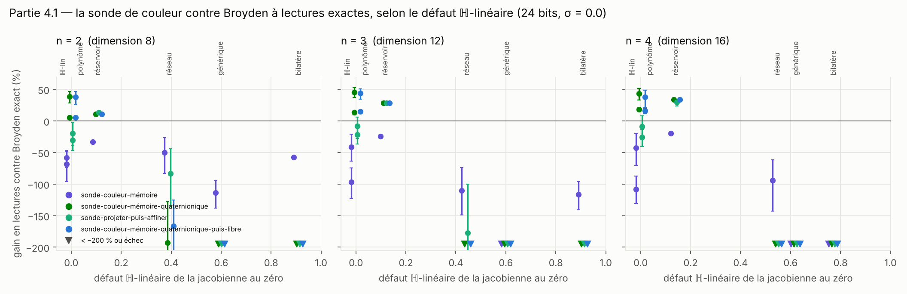
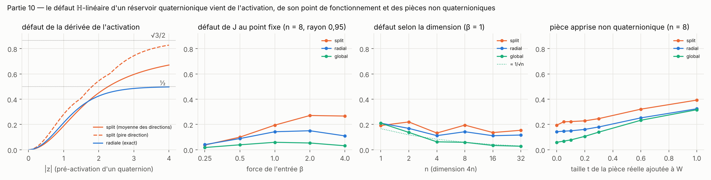
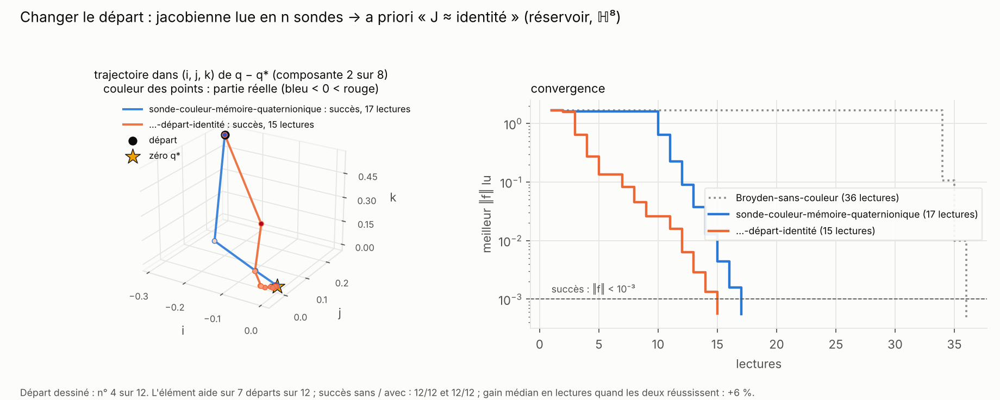
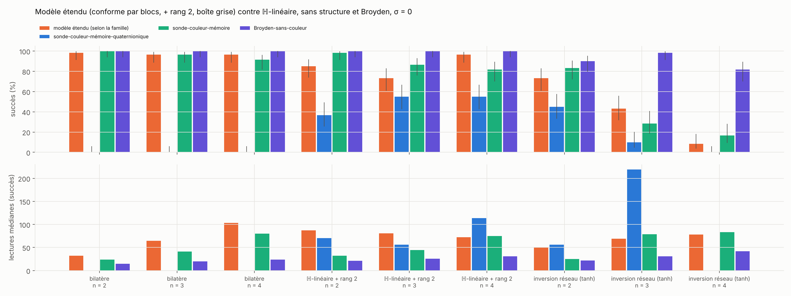
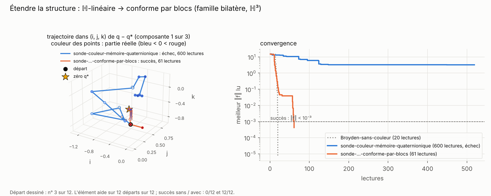
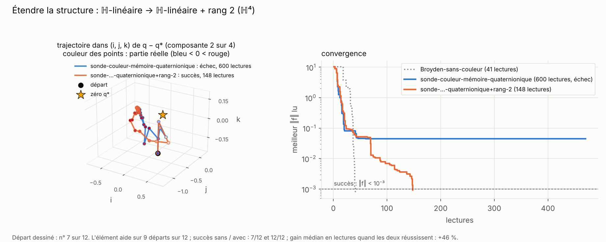
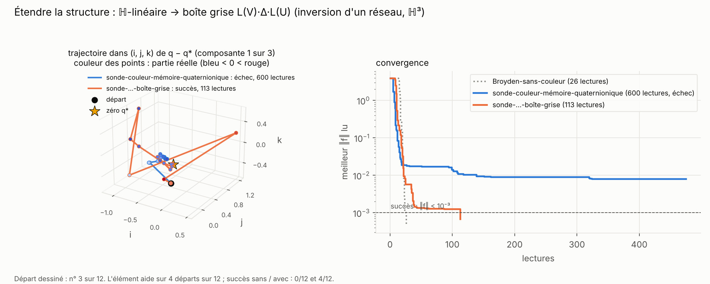

# Partie 4 : autres structures (polynômes, réseaux, réservoirs)

> **En bref.** En partie 3, les fonctions étaient construites pour avoir une jacobienne ℍ-linéaire. Ici, on prend des objets quaternioniques qui ne le sont pas exprès et on mesure leur **défaut ℍ-linéaire** (distance relative de la jacobienne aux matrices à blocs `L(a)`). **Le gain survit tant que le défaut reste petit** (≲ 0,15) : sur le point fixe d'un réservoir, la sonde-couleur-mémoire-quaternionique bat Broyden-sans-couleur de 28 à 34 % ; sur un polynôme non commutatif, de 38 à 45 %. **Au-delà de ~0,4, elle s'effondre.** Sur les réservoirs, on sait faire baisser le défaut (0,02–0,06) mais pas l'annuler, et Broyden-sans-couleur initialisé à l'identité reste devant. **Étendre le modèle de jacobienne rattrape le taux de succès quand la structure manque** (bilatère : 0 % → 97 % avec des blocs conformes ; ℍ-linéaire + rang 2 : 55 % → 97 % à n = 4), **mais ne rend pas la couleur moins chère** que la sonde sans structure ni que Broyden-sans-couleur.
>
> Comme en partie 3, ces gains sont mesurés face à Broyden-sans-couleur, qui ignore la structure. Face à un Broyden quaternionique qui la connaît, la sonde ne gagne pas ; la règle du défaut vaut pour les deux (partie [5.5](../5_armes_egales/README.md#55-même-structure-pour-tous--la-référence-qui-manquait)).

| section | question | verdict |
|---|---|---|
| [4.1 Objets non construits pour](#41-objets-non-construits-pour-la-structure) | le gain de la partie 3 survit-il ? | **oui si le défaut est petit** ; « projeter puis affiner » ne rattrape rien |
| [4.2 Réservoirs](#42-réservoirs--contrôler-le-défaut) | peut-on choisir l'architecture pour que la sonde gagne ? | on contrôle le défaut, **la sonde ne gagne pas** face à Broyden-départ-identité |
| [4.3 Structures étendues](#43-étendre-la-structure-quand-elle-manque) | un modèle entre 4n² et 16n² paramètres aide-t-il ? | **il rattrape le succès, pas le coût** |

## 4.1 Objets non construits pour la structure

Zéro connu `q*`, `d = q − q*`, coefficients quaternioniques aléatoires (`4.1_hors_structure/bench_hors_structure.py`) :

| famille | définition | défaut au zéro (n = 2 / 3 / 4) |
|---|---|---|
| ℍ-linéaire (témoin) | `fᵢ = Σⱼ aᵢⱼ·dⱼ·(1 + ‖dⱼ‖²/2)` | 0 / 0 / 0 |
| polynôme non commutatif | `fᵢ = Σⱼ aᵢⱼ·dⱼ + Σⱼₖ cᵢⱼₖ·dⱼ·dₖ` | 0 / 0 / 0 (au zéro seulement) |
| point fixe d'un réservoir | `f(h) = h − tanh(W·h + b)`, `W` ℍ-linéaire, `tanh` par composante | 0,10 / 0,12 / 0,14 |
| inversion d'un réseau | `f(x) = V·tanh(U·x + b) − y*` | 0,39 / 0,44 / 0,55 |
| générique (témoin) | `f = G·d·(1 + ‖d‖²/2)`, `G` réelle | 0,60 / 0,60 / 0,62 |
| bilatère | `fᵢ = Σⱼ aᵢⱼ·dⱼ·bᵢⱼ` (produits des deux côtés) | 0,91 / 0,91 / 0,77 |

Lectures médianes (succès entre parenthèses s'il est sous 90 %), n = 4, sans bruit, 3 instances × 20 départs, budget 600 :

| famille | sonde-couleur-mémoire | sonde-couleur-mémoire-quaternionique | sonde-projeter-puis-affiner | …-quaternionique-puis-libre | Broyden-sans-couleur | Broyden-mêmes-mesures |
|---|---|---|---|---|---|---|
| ℍ-linéaire | 54 | **23** | 35 (87 %) | 24 | 29 | 61 (88 %) |
| polynôme non commutatif | 94 (52 %) | **32** (88 %) | 69 (72 %) | 31 (82 %) | 69 (75 %) | 86 (57 %) |
| point fixe réservoir | 25 | **14** | 14 | 14 | 21 | 30 |
| inversion réseau | 84 (18 %) | — (0 %) | 145 (15 %) | 145 (13 %) | **42** (85 %) | 102 (33 %) |
| générique | 84 (87 %) | 266 (13 %) | 102 (37 %) | 138 (18 %) | **24** | 87 (87 %) |
| bilatère | 84 (88 %) | — (0 %) | 240 (2 %) | 164 (2 %) | **24** | 73 |

Gain apparié de la sonde-couleur-mémoire-quaternionique contre Broyden-sans-couleur (+ : la sonde est moins chère) : réservoir +11 / +28 / **+34 %** [+32, +35] à n = 2 / 3 / 4 ; polynôme +39 / +45 / +43 % ; témoin ℍ-linéaire +5 / +13 / +18 % ; inversion de réseau −193 % puis échec ; générique et bilatère : échec. Avec bruit `σ = 0,02` : réservoir +24 à +25 %, polynôme +41 à +43 %.

- **Le gain n'est pas un artefact de construction**, mais il demande une jacobienne presque ℍ-linéaire : il tient jusqu'à un défaut de ~0,15 et disparaît vers 0,4.
- **Sur le polynôme, la sonde structurée bat même Broyden en succès** (88 % contre 75 %) : lire 4 fois moins de paramètres rend le modèle plus robuste loin du zéro.
- **« Projeter puis affiner » ne sauve rien** : une mise à jour de rang 1 ne rattrape pas les 12n² paramètres manquants. C'est ce qui motive la section 4.3. Tableaux : [`bench_hors_structure_tables.md`](4.1_hors_structure/bench_hors_structure_tables.md).

## 4.2 Réservoirs : contrôler le défaut

`F(h) = h − σ(W·h + b)`, `W` ℍ-linéaire : la jacobienne `I − Dσ·L(W)` est ℍ-linéaire dès que chaque bloc de `Dσ` est une multiplication à gauche. **Le défaut vient donc entièrement de l'activation** (ou d'une pièce réelle ajoutée à `W`). Trois activations (`4.2_reservoirs/reservoir.py`) : `tanh` par composante (défaut jusqu'à 0,87), `tanh` radial `tanh(‖z‖)·z/‖z‖` (borné par ½), saturation globale `z·tanh(ρ)/ρ` avec `ρ = ‖z‖/√n` (défaut ∝ 1/√n).

**Théorème.** Si `dσ(z) = L(s(z))` partout, la symétrie des dérivées secondes force `s` constant, donc `σ` affine : **on peut baisser le défaut, pas l'annuler.**

Succès % / lectures médianes, ρ = 0,95, β = 1, 3 réservoirs × 10 départs, budget 2000 (`bench_reservoirs.py`) :

| n | activation | défaut | sonde-…-quaternionique | sonde-…-quaternionique-départ-identité | sonde-couleur-mémoire | Broyden-sans-couleur | Broyden-sans-couleur-départ-identité | Picard-sans-couleur |
|---|---|---|---|---|---|---|---|---|
| 8 | `tanh` par composante | 0,19 | 83 % / 22 | 77 % / 55 | 100 % / 41 | 100 % / 37 | 100 % / 18 | 100 % / 28 |
| 8 | saturation globale | 0,06 | 93 % / 16 | 100 % / 16 | 83 % / 40 | 100 % / 36 | 100 % / 12 | 100 % / 16 |
| 32 | `tanh` par composante | 0,15 | 83 % / 55 | 97 % / 37 | 73 % / 147 | 100 % / 133 | 100 % / 18 | 100 % / 22 |
| 32 | saturation globale | 0,03 | 97 % / 55 | 100 % / 27 | 83 % / 145 | 100 % / 132 | 100 % / 15 | 100 % / 18 |

**L'élément ajouté : le départ « J ≈ identité ».** Pour un point fixe, `J = I − Dσ·W` est proche de l'identité. Au lieu de lire `W` avec n sondes, la sonde part de `W₀ = diag(Fᵢ⁻¹)` (direction de chaque `Fᵢ` lue dans la couleur, décade fixée par une seule sonde simultanée). Sur ce départ, elle économise les sondes de lecture et va directement au point fixe.

- **Contre Broyden-sans-couleur en boîte noire, la sonde gagne** d'un facteur 2,5 à 6 (Broyden paie 4n lectures de départ).
- **Contre Broyden-sans-couleur-départ-identité, elle perd, même à défaut 0,02** (6 à 18 lectures à tout n contre 1,2 à 2 fois plus pour la sonde-départ-identité). Le goulot est la dent de scie de la luminosité, qui oblige à des pas amortis, pas la structure.
- **Fragilité** : la sonde-départ-identité tombe à 30 % quand une pièce réelle de 30 % s'ajoute à `W`. Tableaux complets (défaut contrôlé par la force d'entrée et la pièce réelle) : [`bench_reservoirs_tables.md`](4.2_reservoirs/bench_reservoirs_tables.md), [figure](4.2_reservoirs/figures/03_defaut_controle.png).

## 4.3 Étendre la structure quand elle manque

La section 4.1 montre qu'une mise à jour de rang 1 ne rattrape pas une structure fausse. On teste trois modèles de jacobienne intermédiaires, chacun sur la famille pour laquelle il est fait (`src/sonde_hn.py`, `4.3_structures_etendues/bench_structures.py`) :

| modèle (nom du rapport) | `W` | lecture initiale | paramètres | famille visée |
|---|---|---|---|---|
| sonde-couleur-mémoire-conforme-par-blocs | chaque bloc `L(αᵢⱼ)R(βᵢⱼ)` | 3n sondes (directions 1, i, j), 4ᵉ colonne par la structure | 7n² | bilatère (exactement de ce type au zéro) |
| sonde-couleur-mémoire-quaternionique+rang-2 | `L(A) + C`, `C` réelle de rang ≤ 2 | n sondes | 4n² + 16n | ℍ-linéaire + `0,6·‖J‖`·(rang 2) |
| sonde-couleur-mémoire-boîte-grise | `L(V)·Δ·L(U)`, `U` connue, `Δ` diagonale réelle | 2n sondes | 4n² + 3n | inversion d'un réseau à `tanh` par composante (structure **exacte**) |

Mises à jour : Broyden réel puis projection de chaque bloc sur les conformes (Van Loan-Pitsianis) ; moindres carrés alternés sur les 6 dernières sécantes (`A` au plus près, `C` = troncature de rang 2) ; correction de norme minimale de `(V, Δ)`. Vérification : lus avec un capteur exact, les trois modèles retrouvent la jacobienne normalisée (erreur 3·10⁻⁶ pour la boîte grise, 0,06 pour les blocs conformes hors du zéro).

Succès [IC 95 %] / lectures médianes, sans bruit, 3 instances × 20 départs, budget 600 :

| famille | n | défaut ℍ-lin. | **modèle étendu** | sonde-…-quaternionique | sonde-couleur-mémoire | Broyden-sans-couleur | Broyden-mêmes-mesures |
|---|---|---|---|---|---|---|---|
| bilatère | 2 | 0,91 | **98 %** [91 ; 100] / 32 | 0 % | 100 % / 24 | 100 % / 15 | 23 % / 124 |
| bilatère | 4 | 0,77 | **97 %** [89 ; 99] / 104 | 0 % | 92 % / 80 | 100 % / 24 | 18 % / 271 |
| ℍ-lin. + rang 2 | 2 | 0,44 | 85 % [74 ; 92] / 87 | 37 % / 70 | 98 % / 32 | 100 % / 21 | 12 % / 148 |
| ℍ-lin. + rang 2 | 4 | 0,46 | **97 %** [89 ; 99] / **72** | 55 % / 114 | 82 % / 75 | 100 % / 31 | 18 % / 356 |
| inversion réseau | 2 | 0,39 | 73 % [61 ; 83] / 50 | 45 % / 56 | 83 % / 25 | 90 % / 22 | 10 % / 90 |
| inversion réseau | 3 | 0,44 | 43 % [32 ; 56] / 69 | 10 % / 220 | 28 % / 79 | 98 % / 31 | 10 % / 244 |
| inversion réseau | 4 | 0,55 | 8 % [4 ; 18] / 78 | 0 % | 17 % / 84 | 82 % / 42 | 2 % / 479 |

**Premier modèle : blocs conformes.** La famille bilatère, où la sonde ℍ-linéaire échoue à 100 %, est exactement conforme par blocs au zéro : avec 7n² paramètres au lieu de 4n², la sonde y converge.

**Deuxième modèle : ℍ-linéaire + rang faible.** La pièce de rang 2 s'apprend au fil des sécantes : la descente marque des paliers tant que la pièce est mal connue, puis repart. Sans elle, la sonde ℍ-linéaire cale sur un palier qu'elle ne quitte plus.

**Troisième modèle : boîte grise.** Connaître la première couche `U` du réseau et la forme diagonale de `Dσ` donne la jacobienne exacte en 2n sondes, mais la mise à jour ne suit pas la saturation de `tanh` loin du zéro.

- **Le modèle étendu rattrape le taux de succès** là où la structure ℍ-linéaire échoue : bilatère 0 % → 97–98 % ; rang 2 : 55 % → 97 % à n = 4 (gain apparié sur la sonde ℍ-linéaire +34 % [−1 ; +55]) ; boîte grise : 10 % → 43 % à n = 3.
- **Il ne bat pas la sonde sans structure en lectures**, sauf le modèle rang 2 à n = 4 (72 contre 75 lectures, 97 % contre 82 % de succès). Sur la famille bilatère, il coûte 33 à 55 % de plus que la sonde-couleur-mémoire : les 3n sondes de lecture ne compensent pas encore les 16n² paramètres à n ≤ 4, et la projection conforme après chaque mise à jour jette une partie de l'information.
- **Rien ne s'approche de Broyden-sans-couleur** (−113 à −331 % en lectures appariées) : en dehors de la structure ℍ-linéaire elle-même, la couleur reste plus chère que la valeur exacte, comme en dimension 4.
- **La boîte grise ne suffit pas pour l'inversion de réseau** : même avec la structure exacte, le succès tombe de 73 % à 8 % quand n passe de 2 à 4. Le problème est la non-linéarité (saturation), que Broyden-sans-couleur aussi trouve difficile (82 % à n = 4). La partie 6.2 attaque le même problème en changeant l'activation plutôt que le modèle.
- Avec bruit `σ = 0,02`, mêmes tendances (bilatère 88–100 %, rang 2 62–82 %) : [`bench_structures_tables.md`](4.3_structures_etendues/bench_structures_tables.md).
- Les figures (i, j, k) montrent des départs favorables : le modèle aide sur 12/12 départs pour les blocs conformes, sur 9/12 pour le rang 2 à n = 4, mais sur 4/12 seulement pour la boîte grise à n = 3.

Code : `4.1_hors_structure/`, `4.2_reservoirs/` (`reservoir.py`, `defaut_theorie.py`, `bench_reservoirs.py`), `4.3_structures_etendues/bench_structures.py` ; tableaux et figure de 4.3 : `python src/figs_hn.py 43`.
