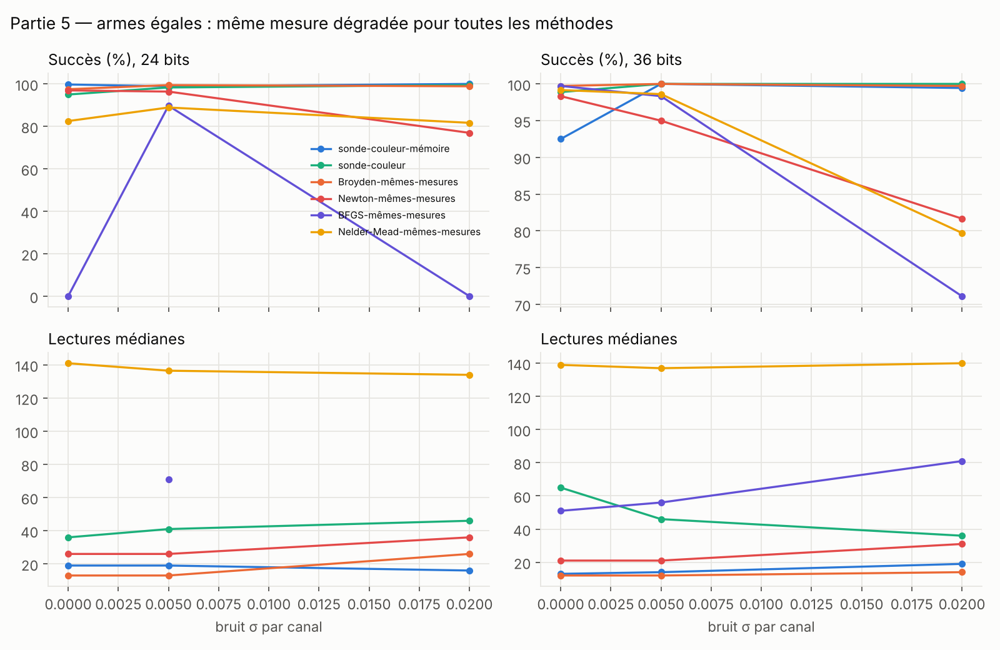
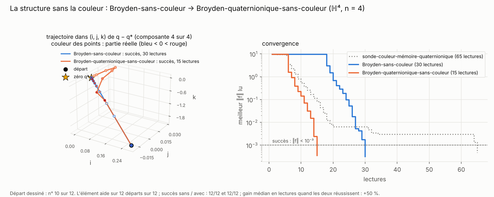
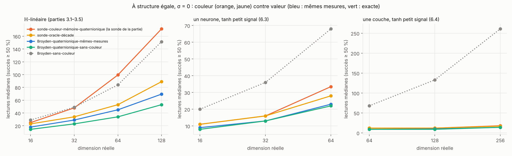
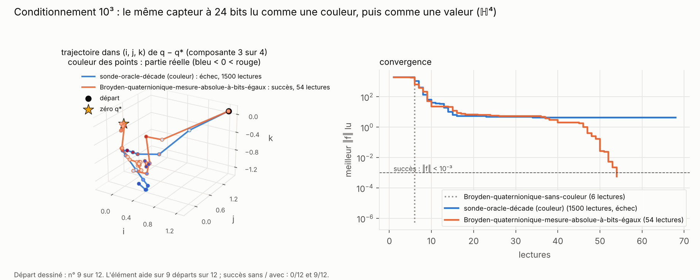
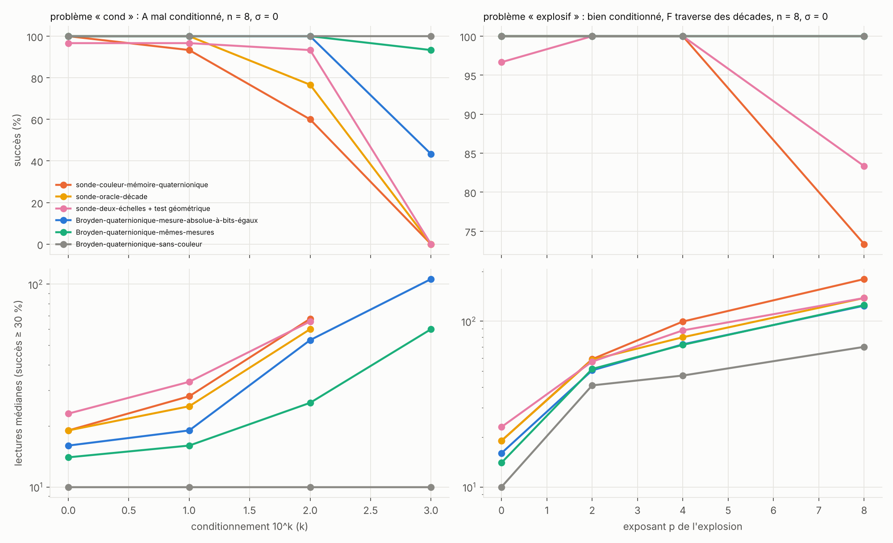
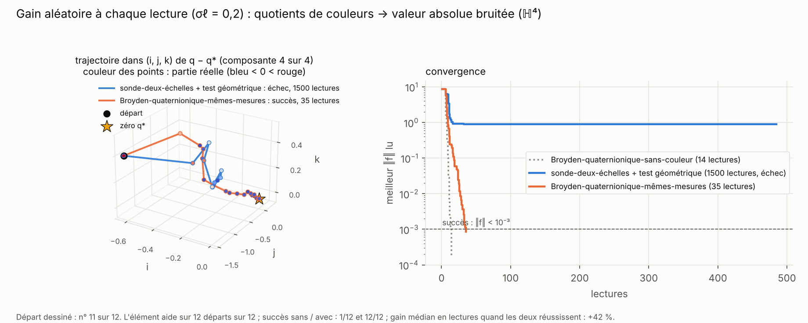
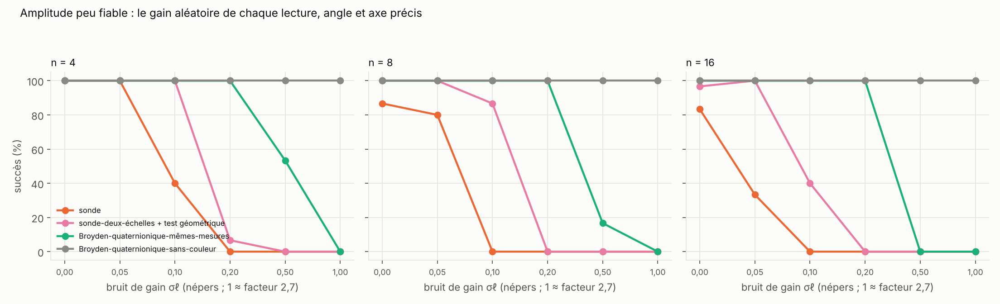
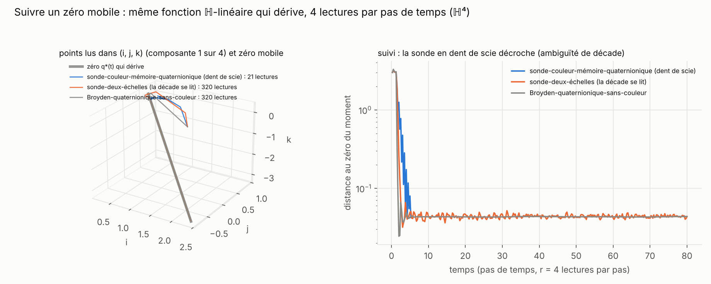
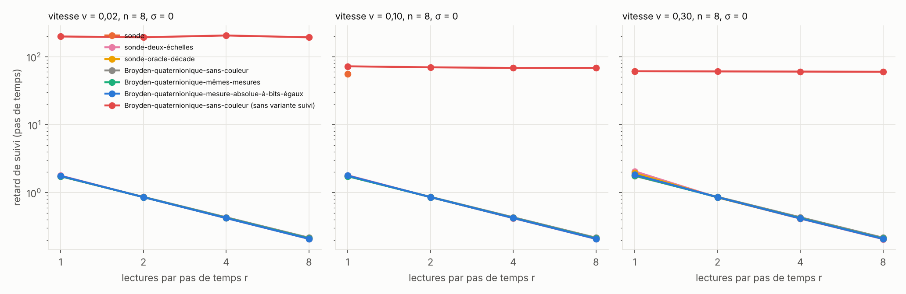

# Partie 5 : à armes égales, la couleur face à la valeur

> **En bref.** Dans les parties 1 à 4, la référence principale est **…-sans-couleur** : une méthode classique qui lit `f` en double précision, alors que la sonde lit une couleur quantifiée. Cette partie rend la comparaison équitable, en deux temps.
>
> **Mêmes mesures (5.1 à 5.4).** Tout le monde lit la même mesure dégradée (mêmes bits, même bruit ; les méthodes classiques reçoivent même une luminosité sans dent de scie). En dimension 4, Broyden-mêmes-mesures reste le plus économe dans 5 cas sur 6. En dimension 4n avec structure ℍ-linéaire, la sonde coûte 2 à 3 fois moins que Broyden-mêmes-mesures, qui s'effondre au-delà de n = 16.
>
> **Même structure (5.5 à 5.8).** Ce gain venait de la structure, que Broyden-mêmes-mesures ignorait. Un **Broyden quaternionique** classique, qui connaît la même structure et lit la valeur, est le moins cher partout : la structure ne demande pas la couleur. À information égale, la couleur coûte 15 à 25 % de lectures de plus. Trois situations qui semblaient favorables à la couleur ont été testées : une boîte noire mal conditionnée (5.6), un capteur dont l'amplitude est peu fiable (5.7), un zéro qui bouge (5.8). Dans aucune la couleur ne gagne. Ce qui reste : **la couleur suffit** pour profiter de la structure.

| section | question | verdict |
|---|---|---|
| [5.1 Dimension 4](#51-dimension-4--fonctions-quelconques-et-möbius) | à mesure égale, la sonde bat-elle Broyden ? | **non**, sauf à 24 bits avec bruit |
| [5.2 Dimension 4n](#52-dimension-4n--structure-ℍ-linéaire) | et avec la structure ℍ-linéaire ? | **oui** : 2 à 3 fois moins de lectures que Broyden-mêmes-mesures |
| [5.3 Autres structures](#53-autres-structures) | hors structure ? | **non** |
| [5.5 Même structure pour tous](#55-même-structure-pour-tous--la-référence-qui-manquait) | face à un Broyden qui connaît la structure ? | **non** : la valeur exacte est la moins chère ; la couleur suffit |
| [5.6 Boîte noire instable](#56-boîte-noire-ℍ-linéaire-instable--la-dent-de-scie-aide-t-elle-) | la dent de scie aide-t-elle quand `F` traverse beaucoup de décades ? | **non** : à conditionnement 10³, la sonde échoue, la valeur à bits égaux passe |
| [5.7 Amplitude peu fiable](#57-capteur-damplitude-peu-fiable) | les quotients protègent-ils d'un gain aléatoire ? | **non** : la couleur est moins robuste que la valeur |
| [5.8 Zéro mobile](#58-suivre-un-zéro-qui-bouge-optimisation-en-temps-réel) | suivre un zéro en temps réel | **égalité** dès que la décade est lue |

## 5.1 Dimension 4 : fonctions quelconques et Möbius

Banc : `bench_armes_egales.py`, figures : `bench_armes_egales_figs.py`. Familles `lin`, `quad`, `cub` + Möbius exacte, couleur-complète-angles, 3 instances × 30 départs. Succès % / lectures médianes :

| bits / `σ` | sonde-couleur-mémoire | sonde-couleur | Broyden-mêmes-mesures | Newton-mêmes-mesures | BFGS-mêmes-mesures | Nelder-Mead-mêmes-mesures |
|---|---|---|---|---|---|---|
| 24 / 0 | 100 / 19 | 95 / 36 | 98 / **13** | 97 / 26 | 0 | 83 / 141 |
| 24 / 0,005 | 99 / 19 | 98 / 41 | 99 / **13** | 96 / 26 | 90 / 71 | 89 / 136 |
| 24 / 0,02 | 100 / **16** | 99 / 46 | 99 / 26 | 77 / 36 | 0 | 82 / 134 |
| 36 / 0 | 93 / 13 | 99 / 65 | 100 / **12** | 98 / 21 | 100 / 51 | 99 / 139 |
| 36 / 0,005 | 100 / 14 | 100 / 46 | 100 / **12** | 95 / 21 | 98 / 56 | 99 / 137 |
| 36 / 0,02 | 99 / 19 | 100 / 36 | 100 / **14** | 82 / 31 | 71 / 81 | 80 / 140 |

Gain apparié de la sonde-couleur-mémoire sur Broyden-mêmes-mesures : −43 %, −42 %, **+30 %** à 24 bits (`σ` = 0 ; 0,005 ; 0,02) ; −17 %, −24 %, −34 % à 36 bits.

Les améliorations de la sonde (dithering, partie 1.4) ne changent pas ce verdict : avec dithering, la sonde gagne dans 1 cas sur 4 face à Broyden-mêmes-mesures (−23 %, +21 %, −9 %, −21 %).

## 5.2 Dimension 4n : structure ℍ-linéaire

Mêmes bancs que les parties [3.1](../3_dimension_4n/README.md#31-jacobienne-ℍ-linéaire-n--1-à-4) et [3.2](../3_dimension_4n/README.md#32-grande-dimension-n--8-16-32), couleur-complète-angles 24 bits par composante. Ici les chiffres viennent de ces parties, regroupés.

Gain apparié de la sonde-couleur-mémoire-quaternionique sur Broyden-mêmes-mesures (+ : la sonde est moins chère ; ε = 0, sans bruit) : **+35 %** à n = 1, **+48 %** à n = 2, **+55 %** à n = 3, **+59 %** [+55, +62] à n = 4. Avec bruit `σ = 0,02` : +45 à +72 %.

En grande dimension (succès % / lectures médianes, budget 2000) :

| n | σ | sonde-couleur-mémoire-quaternionique | Broyden-mêmes-mesures | Broyden-sans-couleur (rappel) |
|---|---|---|---|---|
| 8 | 0 | 90 % / 47 | 73 % / 138 | 100 % / 49 |
| 8 | 0,02 | 87 % / 65 | 100 % / 489 | 100 % / 49 |
| 16 | 0 | 83 % / 97 | 43 % / 491 | 100 % / 84 |
| 16 | 0,02 | 77 % / 123 | 0 % | 100 % / 84 |
| 32 | 0 | 63 % / 167 | 0 % | 100 % / 151 |
| 32 | 0,02 | 7 % / 171 | 0 % | 100 % / 151 |

## 5.3 Autres structures

Partie [4.1](../4_autres_structures/README.md#41-objets-non-construits-pour-la-structure), n = 4 (dimension 16), sans bruit. Lectures médianes, succès entre parenthèses s'il est inférieur à 90 % :

| famille | sonde-couleur-mémoire-quaternionique | Broyden-mêmes-mesures |
|---|---|---|
| ℍ-linéaire (témoin) | **23** | 61 (88 %) |
| polynôme non commutatif | **32** (88 %) | 86 (57 %) |
| point fixe d'un réservoir | **14** | 30 |
| inversion d'un réseau | — (0 %) | **102** (33 %) |
| générique (témoin) | 266 (13 %) | **87** (87 %) |
| bilatère | — (0 %) | **73** |

## 5.4 Ce que l'on voit

- **En dimension 4, Broyden-mêmes-mesures est le plus économe dans 5 cas sur 6.** La sonde ne gagne qu'à 24 bits avec bruit 0,02, et elle **résiste mieux au bruit** que les méthodes à différences finies (Newton-mêmes-mesures 77 %, BFGS-mêmes-mesures 71 %).
- **En dimension 4n, la structure change tout** : lire n coefficients quaternioniques au lieu de 4n colonnes rend la sonde 2 à 3 fois moins chère que Broyden-mêmes-mesures. Broyden, qui doit relire 4n directions par différences finies sur une mesure dégradée, s'effondre dès n = 16 (0 % avec bruit).
- **Sans structure, l'avantage s'inverse** (familles générique, bilatère, inversion de réseau).
- Curiosité qui a lancé la partie 1.4 : à 24 bits, la sonde fait **mieux avec un peu de bruit** (16 lectures) que sans (19).
- Réserve : réglage limité à 3–4 configurations par méthode ; le BFGS-mêmes-mesures à 0 % vient d'un réglage défavorable.

## 5.5 Même structure pour tous : la référence qui manquait

**Le trou dans les comparaisons.** Dans les parties 3, 4 et 6, la sonde exploite une structure : blocs `L(a)` (ℍ-linéaire), `R(b)` (poids d'un neurone), diagonale par sortie (couche). Les méthodes classiques auxquelles on la comparait **l'ignoraient** : Broyden-sans-couleur lit 4n directions au départ. Or la structure ne demande pas la couleur. Si un bloc vaut `L(a)`, une différence finie le long de la direction réelle 1 donne `L(a)·1 = a` : le coefficient quaternionique entier, sur la valeur exacte aussi. La référence juste est donc un **Broyden quaternionique** classique (`broyden_q` dans `src/sonde_hn.py`) : même modèle de jacobienne que la sonde, même mise à jour qui garde la structure, mais il lit la valeur de `f` et démarre en n lectures au lieu de 4n.

On le lance en deux versions, **sans couleur** (valeur exacte) et **mêmes mesures** (la mesure dégradée de la partie 5, luminosité absolue, pas de différence finie 0,5 ou 1, le meilleur par case). En face, la comparaison la plus stricte est la **sonde-oracle-décade** : la sonde à qui l'on donne la décade, qui a donc exactement l'information de la mesure dégradée.

**L'élément ajouté : la structure, sans la couleur.** Même problème ℍ-linéaire qu'en partie 3 (n = 4). Broyden-sans-couleur paie 16 lectures de départ (4n) ; le Broyden quaternionique en paie 4 (n), puis suit pratiquement le même chemin. La sonde, qui lit la même structure dans les couleurs, est en pointillés.

Banc : `bench_meme_structure.py`, mêmes problèmes et mêmes départs que les parties 3.2, 6.3 et 6.4. Tableaux complets avec intervalles, bruit 0,02 et gains appariés : [`bench_meme_structure_tables.md`](bench_meme_structure_tables.md). Succès % / lectures médianes, sans bruit :

| problème | taille | sonde (de sa partie) | sonde-oracle-décade | Broyden-quaternionique-mêmes-mesures | Broyden-quaternionique-sans-couleur | Broyden-sans-couleur |
|---|---|---|---|---|---|---|
| ℍ-linéaire | n = 4 | 99 / 25 | 100 / 23 | 100 / 18 | 100 / **14** | 100 / 29 |
| ℍ-linéaire | n = 16 | 82 / 100 | 100 / 53 | 100 / 45 | 100 / **34** | 100 / 84 |
| ℍ-linéaire | n = 32 | 86 / 172 | 95 / 89 | 100 / 70 | 100 / **53** | 100 / 152 |
| neurone, identité | n = 16 | 90 / 33 | 100 / 29 | 100 / 23 | 100 / **18** | 100 / 66 |
| neurone, `tanh` petit signal | n = 16 | 93 / 34 | 100 / 28 | 100 / 23 | 100 / **22** | 100 / 68 |
| neurone, `tanh` radial (défaut 0,27) | n = 8 | 3 / 36 | 7 / 37 | 97 / 70 | 100 / 72 | 100 / **46** |
| neurone, `tanh` radial | n = 16 | 0 | 0 | 77 / 132 | 93 / 156 | 100 / 92 |
| couche, identité | 8 × 8 (dim. 256) | 100 / 18 | 100 / 18 | 100 / 13 | 100 / **10** | 100 / 258 |
| couche, `tanh` petit signal | 8 × 8 | 100 / 18 | 100 / 17 | 100 / 14 | 100 / **14** | 100 / 261 |
| couche, `tanh` radial | 8 × 8 | 0 | non lancée | 60 / 143 | 97 / 215 | 100 / **286** |

- **À structure égale, la valeur exacte est la moins chère.** Le Broyden quaternionique coûte 14, 23, 34 et 53 lectures à n = 4, 8, 16 et 32 sur le problème ℍ-linéaire : 40 à 69 % de moins que la sonde de base, et **50 à 65 % de moins que Broyden-sans-couleur** (gains appariés, intervalles de ±3 points). Le gain des parties 3, 4 et 6 venait de la **structure**, pas de la couleur.
- **À information égale, la couleur coûte un peu.** Broyden-quaternionique-mêmes-mesures coûte 15 à 22 % de moins que la sonde-oracle-décade (jusqu'à 39 % avec bruit 0,02), qui lit pourtant la même chose. Les deux réussissent toujours. La couleur ne bloque donc pas : à 24 bits, avec la luminosité connue à une décade près, **elle suffit** pour profiter de la structure.
- **Sans la décade, l'écart se creuse**, car la sonde doit lever l'ambiguïté (partie 3). Avec le capteur à deux échelles à bits égaux, la sonde revient à 97–99 % de succès mais reste à 71 et 122 lectures (n = 16 et 32), contre 45 et 70 pour la mesure absolue.
- **Le Broyden quaternionique est un résultat en soi** : n lectures de départ au lieu de 4n, 2 à 2,5 fois moins de lectures que Broyden-sans-couleur sur ces familles. C'est une mise à jour sécante structurée au sens de Schubert (1970) et de Dennis et Walker (1981) ([références](../../docs/REFERENCES.md)), dont le sous-espace est propre aux quaternions et dont le côté (gauche ou droite) doit suivre la place de l'inconnue. Pour une couche, son coût **ne dépend pas du nombre de sorties** (6 lectures pour une couche d'identité à 4 ou 8 sorties et 4 poids).
- **En régime saturé, la sonde s'effondre, pas la structure.** À `tanh` radial (défaut 0,27), la sonde-oracle-décade réussit 7 % des départs (n = 8) et 0 % (n = 16) ; le Broyden quaternionique, 100 % puis 93 %. Le défaut pèse quand même sur lui : Broyden-sans-couleur, sans structure, est moins cher sur le neurone saturé (46 contre 72 lectures à n = 8), et la version mêmes-mesures perd en fiabilité (60 % sur la couche 8 × 8). La partie [6.5](../6_reseaux/README.md#65-pourquoi-la-sonde-seffondre-en-régime-saturé) cherche pourquoi la sonde, elle, s'effondre.
- **Limites.** Les problèmes sont ceux des parties d'origine, construits pour avoir la structure. Le pas de différence finie de la version mêmes-mesures est réglé (0,5 ou 1, le meilleur par case), un réglage favorable comme celui de la sonde. La sonde-oracle n'a pas été lancée sur les couches en `tanh` radial (elle est déjà à 0–7 % pour un neurone). La colonne « sonde » vient de la partie d'origine (sonde-garde-ambiguïté pour l'ℍ-linéaire, à droite pour le neurone, par sortie pour la couche), avec ses départs et ses budgets.

## 5.6 Boîte noire ℍ-linéaire instable : la dent de scie aide-t-elle ?

> **Résultat : non, c'est l'inverse.** Quand `F` traverse beaucoup de décades, la luminosité en dent de scie ne donne aucun avantage. À conditionnement 10³, la sonde échoue (0 %, même avec la décade donnée) ; le même capteur à 24 bits, lu comme une valeur, réussit 43 à 73 % des départs.

**La question.** La luminosité a une précision relative constante à toute échelle : c'était l'argument pour la couleur face à un système qui change d'échelle. La référence « mêmes mesures » de 5.5 lisait une luminosité absolue de plage illimitée sans payer de bits, ce qui l'avantage. Ici la mesure absolue est **payée** : c'est le capteur à deux échelles de la partie 3.5 (24 bits : luminosité fine 5, angle 5, axe 5 + 5, luminosité grossière 4 sur 10 décades, de 10⁻⁴ à 10⁶), lu comme une valeur. Hors de la fenêtre, la luminosité grossière est écrêtée.

**Les problèmes.** `A = U·diag(10^{k sᵢ})·V†`, avec `U`, `V` quaternioniques unitaires :
- « cond » : `f = A(q − q*)`, conditionnement 10^k, k = 0 à 3 (défaut ℍ-linéaire nul pour tout k) ;
- « explosif » : `A` unitaire et `f = A·(dⱼ(1 + ½‖dⱼ‖²)^p)ⱼ` : `‖f‖` croît comme `‖d‖^{2p+1}`, p = 2, 4, 8.

n = 4 et 8 (σ = 0 et 0,02), 16 (σ = 0) ; 3 matrices × 10 départs, budget 3000, succès si `‖f‖ < 10⁻³`. Banc : `bench_boite_instable.py`, tableaux : [`bench_boite_instable_tables.md`](bench_boite_instable_tables.md).

**L'élément changé : lire le même capteur comme une valeur.** À conditionnement 10³ (n = 4), la sonde-oracle-décade cale sur un palier vers `‖f‖ ≈ 4` qu'elle ne quitte plus ; le Broyden quaternionique qui lit le même capteur comme une valeur passe ce palier et converge.

Succès %, σ = 0 :

| problème | n | sonde | sonde-oracle-décade | sonde-deux-échelles + test géom. | Broyden-quaternionique à bits égaux | Broyden-quaternionique-mêmes-mesures | Broyden-quaternionique-sans-couleur |
|---|---|---|---|---|---|---|---|
| cond k = 2 | 8 | 60 | 77 | 93 | 100 | 100 | 100 |
| cond k = 2 | 16 | 7 | 87 | 33 | 100 | 100 | 100 |
| cond k = 3 | 4 | 0 | 0 | 0 | 73 | 93 | 100 |
| cond k = 3 | 8 | 0 | 0 | 0 | 43 | 93 | 100 |
| cond k = 3 | 16 | 0 | 0 | 0 | 53 | 100 | 100 |
| explosif p = 8 | 8 | 73 | 100 | 83 | 100 | 100 | 100 |
| explosif p = 8 | 16 | 23 | 40 | 10 | 90 | 100 | 100 |

- **À conditionnement 10³, toutes les sondes échouent, même avec la décade donnée** : l'ambiguïté de décade n'est pas la cause. Les méthodes qui lisent une valeur, même quantifiée, y arrivent. L'explication la plus simple est une limite d'information : la quantification relative (24 bits par composante, sur `log‖Fᵢ‖` et sur la direction) ne résout pas les petites composantes de `W` quand `A` est mal conditionnée. Elle n'a pas été isolée par une expérience dédiée.
- **Sur la dynamique explosive**, la mesure absolue à bits égaux (90 % à n = 16, p = 8) bat nettement la sonde-deux-échelles qui lit le même capteur (10 %).
- **La fenêtre finie a un prix** (43–73 % contre 93–100 % pour la plage illimitée à k = 3), mais plus petit que celui du modèle de la sonde.
- Le Broyden quaternionique à valeur exacte réussit partout : l'instabilité ne gêne pas la structure, elle gêne la mesure.

**Limite.** Matrices synthétiques ; la fenêtre (10⁻⁴ à 10⁶) est choisie pour contenir le seuil de succès. Le test montre que ni le mauvais conditionnement ni la dynamique explosive ne favorisent la couleur, pas qu'aucune situation ne le fait.

## 5.7 Capteur d'amplitude peu fiable

> **Résultat : la couleur est moins robuste, pas plus.** Avec un gain aléatoire indépendant à chaque lecture (angle et axe exacts), la sonde cesse de converger dès σℓ = 0,1 à 0,2 népers, alors que la valeur absolue bruitée tient jusqu'à σℓ = 0,2 et se dégrade à 0,5.

**L'idée testée.** Un interféromètre ou un polarimètre mesure bien une phase ou une direction et mal une amplitude. Un gain **commun** à deux lectures disparaît dans les quotients de la sonde ; on espérait donc que la couleur résiste mieux. On met un bruit gaussien d'écart-type σℓ sur `ln r`, indépendant à chaque lecture (σℓ = 1 ≈ facteur 2,7), sans bruit sur l'angle ni sur l'axe. Même problème ℍ-linéaire qu'en 3.2 et 5.5, 24 bits, 3 matrices × 10 départs. Banc : `bench_gain_amplitude.py`, tableaux : [`bench_gain_amplitude_tables.md`](bench_gain_amplitude_tables.md).

**L'élément changé : la valeur à la place des quotients.** À σℓ = 0,2 (n = 4), la sonde-deux-échelles cale vers `‖f‖ ≈ 1` ; le Broyden quaternionique qui lit la valeur absolue bruitée converge en 35 lectures.

Succès %, n = 4 / n = 8 :

| σℓ (népers) | sonde | sonde-deux-échelles + test géom. | Broyden-quaternionique-mêmes-mesures | Broyden-quaternionique-sans-couleur (sans bruit) |
|---|---|---|---|---|
| 0 | 100 / 87 | 100 / 100 | 100 / 100 | 100 / 100 |
| 0,1 | 40 / 0 | 100 / 87 | 100 / 100 | 100 / 100 |
| 0,2 | 0 / 0 | 7 / 0 | 100 / 100 | 100 / 100 |
| 0,5 | 0 / 0 | 0 / 0 | 53 / 17 | 100 / 100 |
| 1,0 | 0 / 0 | 0 / 0 | 0 / 0 | 100 / 100 |

À n = 16, la sonde-deux-échelles tient jusqu'à σℓ = 0,05 (100 %), passe à 40 % à 0,1 et 0 % à 0,2 ; la valeur absolue bruitée est à 100 % à 0,2 et 0 % à 0,5.

- **Les quotients n'éliminent qu'un gain commun.** Un gain indépendant à chaque lecture entre deux fois dans le quotient de deux lectures, une seule fois dans une valeur. La sonde perd donc d'abord.
- La décomposition plus fine (part du test de descente, qui compare des quotients bruités) n'a pas été faite.
- À σℓ ≥ 0,5, toutes les méthodes qui mesurent échouent.

**Limite.** Le bruit est un gain log-gaussien sans corrélation entre lectures. Un gain qui dérive lentement (corrélé dans le temps) serait le cas favorable à la couleur ; il n'est pas testé.

## 5.8 Suivre un zéro qui bouge (optimisation en temps réel)

> **Résultat : égalité.** Dès que la décade de la luminosité est lue (capteur à deux échelles ou valeur), toutes les méthodes suivent un zéro mobile avec le même retard, environ 1,7 / r pas de temps pour r lectures par pas. La sonde de base, dont la luminosité en dent de scie est ambiguë, décroche.

**Protocole.** Le monde avance pendant qu'on lit : la k-ième lecture voit `F(·, t)` avec `t = k / r`, où r ∈ {1, 2, 4, 8} est le nombre de lectures par pas de temps. `F(q, t) = A(t)·(q − q*(t))`, avec `A(t) = A₀ + 0,3 sin(0,15 t)·B` (ℍ-linéaire à tout instant) et un zéro qui dérive en ligne droite à la vitesse v ∈ {0,02 ; 0,1 ; 0,3}. 80 pas, n = 4 et 8, σ = 0 et 0,02, 3 matrices × 5 départs. Mesure : médiane, sur les 40 derniers pas, de la distance du meilleur point lu au zéro du moment, divisée par v. C'est un **retard**, en pas de temps. Banc : `bench_suivi.py`, tableaux : [`bench_suivi_tables.md`](bench_suivi_tables.md).

**Une adaptation nécessaire.** Les méthodes du rapport comparent des valeurs lues à des instants différents (test de descente, recherche linéaire) et refusent presque tous les pas quand la fonction change. Toutes ont donc une variante « suivi » : pas de Newton complet toujours accepté, pas de différence finie de 0,5. Le contrôle est le Broyden quaternionique de 5.5 sans cette adaptation.

**Ce qu'on voit dans (i, j, k).** n = 4, v = 0,1, r = 4. La sonde-deux-échelles et le Broyden quaternionique restent à environ 0,04 du zéro qui dérive ; la sonde en dent de scie s'arrête après 21 lectures.

Retard médian (pas de temps), toutes cases confondues (σ = 0 ou 0,02, n = 4 ou 8, v quelconque) :

| lectures par pas r | 1 | 2 | 4 | 8 |
|---|---|---|---|---|
| méthodes qui lisent la décade (sonde-deux-échelles, sonde-oracle-décade, Broyden quaternionique exact, mêmes mesures, à bits égaux) | 1,73 – 1,81 (2,06 au pire) | 0,84 – 0,87 | 0,41 – 0,43 | 0,20 – 0,22 |
| Broyden quaternionique sans l'adaptation | 60 – 200 (ne suit pas) | idem | idem | idem |
| sonde de base (dent de scie) | décroche (au mieux 5 runs sur 15) | décroche | décroche | décroche |

- **Le retard vaut environ 1,7 / r, quels que soient v, n, le bruit et la méthode**, pourvu que la décade soit lue. Il ne dépend pas de la méthode : ce n'est pas une propriété de la couleur.
- **Le bruit σ = 0,02 ne change rien** : l'erreur de suivi est dominée par le mouvement du zéro.
- **La sonde de base décroche** : sa luminosité modulo une décade lui donne de faux pas dès que `F` change de décade pendant la dérive.
- **Sans l'adaptation, rien ne suit** : c'est l'absence de test de descente qui compte, pas la méthode.

**Limite.** Modèle ℍ-linéaire, dérive lisse. Un zéro qui saute ou un modèle non linéaire mobile ne sont pas testés, et aucune méthode n'exploite un modèle de la dérive (prédiction-correction).

## 5.9 Bilan de la partie

Sur le problème ℍ-linéaire, on peut passer de Broyden-sans-couleur à la sonde en changeant un seul ingrédient à la fois. La structure divise le coût par 2,5 à 3 ; la quantification, les quotients de couleurs puis la décade inconnue le font remonter, jusqu'à dépasser Broyden-sans-couleur à n = 32.

Détails de 5.1 : [`bench_armes_egales_tables.md`](bench_armes_egales_tables.md).
