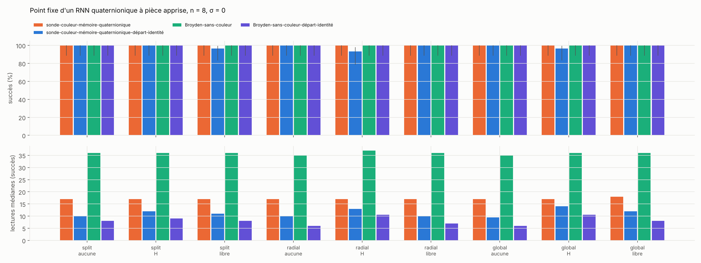
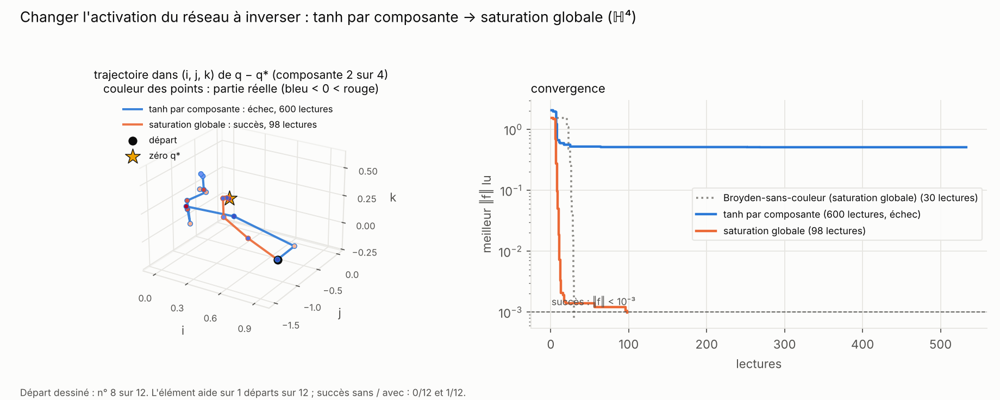
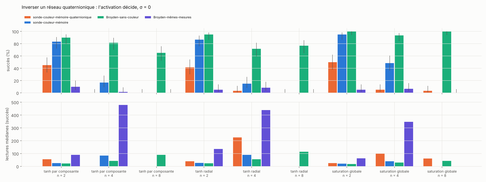
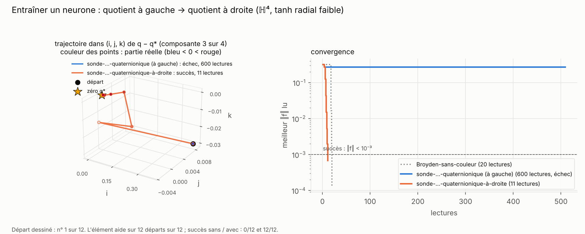
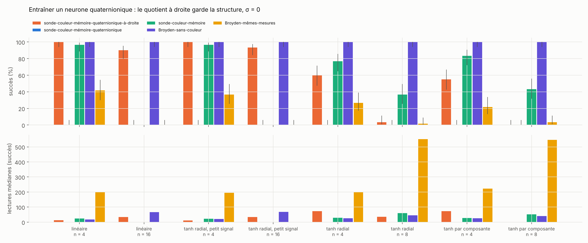
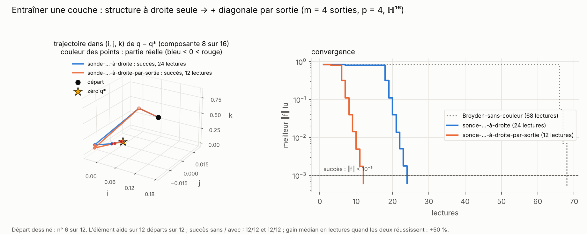
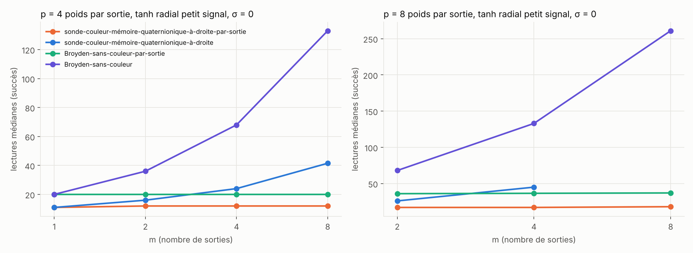
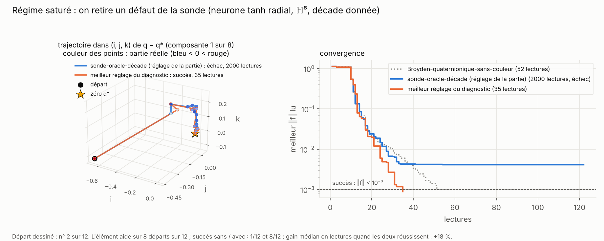
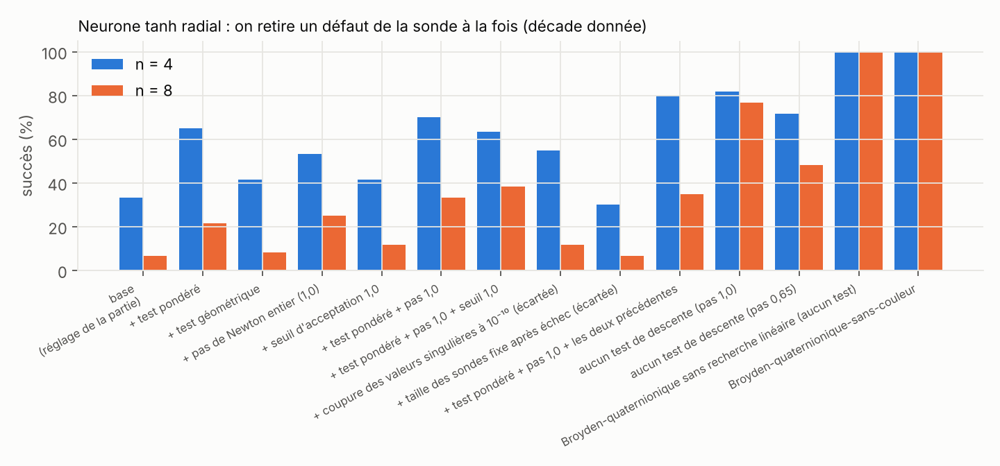

# Partie 6 : réseaux de neurones quaternioniques

> **En bref.** Les parties 3 et 4 donnent une règle : la structure fait gagner quand la jacobienne est presque structurée. On la met à l'épreuve sur des réseaux de neurones quaternioniques.
>
> - **Points fixes d'un RNN (6.1).** Avec une entrée constante et une pièce apprise, la sonde reste 2 fois moins chère que Broyden-sans-couleur en boîte noire, mais Broyden-départ-identité reste devant, comme en 4.2. Quand le réseau a plusieurs points fixes, **le degré lu dans les couleurs certifie chacun de ceux que la sonde trouve (13 sur 13)**.
> - **Inverser un réseau (6.2).** Changer l'activation baisse le défaut (0,55 → 0,13–0,27) sans sauver la sonde.
> - **Entraîner un neurone (6.3).** La jacobienne par rapport aux poids est une multiplication **à droite** ; avec un quotient à droite, elle est exactement structurée et la sonde coûte 31 à 56 % de moins que Broyden-sans-couleur quand l'activation est presque linéaire, jusqu'à la dimension 64.
> - **Entraîner une couche (6.4).** Avec m sorties, la jacobienne est en plus diagonale par sortie : **p sondes suffisent, quel que soit m** (11 à 18 lectures jusqu'à la dimension 256).
> - **Pourquoi la sonde s'effondre en régime saturé (6.5).** Le test de descente en explique l'essentiel (7 % → 77 % de succès sans lui, à n = 8) ; le reste n'est pas expliqué.
>
> Comme en partie 3, le gain vient de la structure, pas de la couleur : un **Broyden quaternionique à droite par sortie**, qui lit la valeur, coûte 6 à 10 lectures pour une couche d'identité quel que soit le nombre de sorties, contre 13 à 18 pour la sonde, et il tient en régime saturé (partie [5.5](../5_armes_egales/README.md#55-même-structure-pour-tous--la-référence-qui-manquait)).

| section | question | verdict |
|---|---|---|
| [6.1 Points fixes](#61-points-fixes-dun-rnn-quaternionique) | entrée constante, pièce apprise, plusieurs points fixes, certificat | la sonde bat Broyden en boîte noire, pas Broyden-départ-identité ; **certificat 13/13** |
| [6.2 Inverser un réseau](#62-inverser-un-réseau-quaternionique) | une activation radiale ou globale sauve-t-elle l'inversion ? | **non** |
| [6.3 Entraîner un neurone](#63-entraîner-un-neurone-quaternionique--le-quotient-à-droite) | un Broyden quaternionique « à droite » s'applique-t-il ? | **oui** : −31 à −56 % de lectures face à Broyden-sans-couleur |
| [6.4 Entraîner une couche](#64-entraîner-une-couche-entière--la-structure-par-sortie) | une couche à m sorties coûte-t-elle m fois plus ? | **non** : p sondes quel que soit m ; mais le Broyden quaternionique par sortie fait mieux |
| [6.5 Régime saturé](#65-pourquoi-la-sonde-seffondre-en-régime-saturé) | pourquoi la sonde s'effondre-t-elle quand l'activation sature ? | **le test de descente**, pour l'essentiel ; le reste n'est pas expliqué |

Toutes les sondes de cette partie sont dans `src/sonde_hn.py` (vérifiée identique à la sonde des parties 3.1 et 3.4 par `tests/test_sonde_hn.py`) ; couleur-complète-angles 24 bits par composante. Tableaux complets : `python src/figs_hn.py 61 62 63 64 65`.

## 6.1 Points fixes d'un RNN quaternionique

RNN à entrée constante `h ← σ(W·h + U·x + b)` ; ses points fixes sont les zéros de `F(h) = h − σ(W·h + U·x + b)`, de jacobienne `I − Dσ·W` (Sussillo et Barak, 2013). `W = W₀ + P` : `W₀` quaternionique **gelée** (rayon spectral 0,6), `P` la **pièce apprise**, dans l'esprit du dépôt half-frozen-rnn (`rnn.py`).

**La tâche apprise : une mémoire associative.** Pour deux entrées `xₖ`, on veut que le point fixe soit une cible `h*ₖ` donnée (le point fixe du réseau gelé, déplacé de 0,3 par quaternion). La condition `(W₀ + P)·h*ₖ = σ⁻¹(h*ₖ) − U·xₖ − b` est linéaire en `P` : on l'apprend exactement par moindres carrés, de trois façons :

| pièce | contrainte | défaut de `P` (n = 8) |
|---|---|---|
| aucune | réseau gelé, pas d'apprentissage (le point fixe manque la cible : erreur 0,16–0,36) | — |
| ℍ-linéaire | `P` à blocs `L(pᵢⱼ)` | 0,00 |
| pénalisée | `P` réelle, pénalité λ‖P − proj(P)‖² (λ = 1 ou 0,1) | 0,00–0,04 |
| libre | `P` réelle quelconque | 0,84–0,88 |

Toutes les pièces apprennent la tâche (erreur de mémoire ≤ 0,01 avec `tanh` par composante ou saturation globale, 0,08–0,10 avec `tanh` radial). On cherche ensuite le point fixe de chaque entrée depuis un départ à 0,5·√n (comme en 4.2). n = 8, sans bruit, 3 réseaux × 10 départs, succès / lectures médianes :

| activation | pièce | défaut de J au point fixe | sonde-…-quaternionique | sonde-…-départ-identité | sonde-relecture | Broyden-sans-couleur | Broyden-sans-couleur-départ-identité |
|---|---|---|---|---|---|---|---|
| `tanh` par composante | aucune | 0,17 | 100 % / 17 | 100 % / 10 | 100 % / 24 | 100 % / 36 | 100 % / 8 |
| `tanh` par composante | ℍ-linéaire | 0,17 | 100 % / 17 | 100 % / 12 | 100 % / 24 | 100 % / 36 | 100 % / 9 |
| `tanh` par composante | libre | 0,17 | 100 % / 17 | 97 % / 11 | 100 % / 24 | 100 % / 36 | 100 % / 8 |
| saturation globale | aucune | 0,03 | 100 % / 17 | 100 % / 10 | 100 % / 24 | 100 % / 35 | 100 % / 6 |
| saturation globale | ℍ-linéaire | 0,10 | 100 % / 17 | 97 % / 14 | 100 % / 24 | 100 % / 36 | 100 % / 10 |
| saturation globale | pénalisée (λ = 0,1) | 0,10 | 100 % / 17 | 100 % / 14 | 100 % / 24 | 100 % / 36 | 100 % / 10 |
| saturation globale | libre | 0,15 | 100 % / 18 | 100 % / 12 | 100 % / 24 | 100 % / 36 | 100 % / 8 |

- **La sonde reste à 17 lectures quelle que soit la pièce apprise**, contre 36 pour Broyden-sans-couleur en boîte noire. **Broyden-sans-couleur-départ-identité reste devant** (6 à 10 lectures) : le bon a priori pour un point fixe compte plus que la couleur (même conclusion qu'en 4.2).
- **Contraindre la pièce à rester ℍ-linéaire ne baisse pas le défaut de J.** Le défaut vient de `Dσ·W` ; une pièce ℍ-linéaire, plus contrainte, est plus grande (‖P‖ ≈ 1,3 à 5 ‖W₀‖ contre 0,4 à 1,4 pour la pièce libre, sur nos premiers tirages), et `Dσ` multiplie un `W` plus gros. Avec la saturation globale, la pièce ℍ-linéaire donne 0,10 contre 0,15 pour la libre : un petit gain, sans effet sur les lectures.
- Avec bruit `σ = 0,02`, mêmes conclusions (93–100 % de succès à n = 8). À n = 4 avec la saturation globale, une pièce apprise fait baisser le succès de toutes les méthodes à 80–90 %, Broyden-départ-identité compris : la pièce rend le point fixe plus raide. La relecture (partie 3.4) coûte 7 lectures de plus sans rien apporter ici : à n ≤ 8 il n'y a presque pas d'ambiguïté. Tableaux : [`bench_points_fixes_tables.md`](bench_points_fixes_tables.md).

**Plusieurs points fixes.** Un RNN n'a plusieurs points fixes que si son activation sature : `W ≈ 2,5·(rotation faible)` et `tanh` par composante donnent 24 à 46 points fixes pour n = 1, 232 à 249 pour n = 2 (trouvés par Newton exact depuis 400 départs). Depuis 40 départs uniformes, budget 600 :

| n | réseau | points fixes | défaut moyen | méthode | succès | points distincts trouvés | lectures totales | **degré lu = signe de det J** |
|---|---|---|---|---|---|---|---|---|
| 1 | 0 | 24 | 0,74 | sonde-…-quaternionique | 60 % | 5 | 11 184 | **5/5** |
| 1 | 0 | 24 | 0,74 | sonde-couleur-mémoire | 45 % | 12 | 14 270 | |
| 1 | 0 | 24 | 0,74 | Broyden-sans-couleur | 28 % | 7 | 17 590 | |
| 1 | 1 | 46 | 0,76 | sonde-…-quaternionique | 70 % | 8 | 8 798 | **8/8** |
| 1 | 1 | 46 | 0,76 | sonde-couleur-mémoire | 88 % | 20 | 4 138 | |
| 1 | 1 | 46 | 0,76 | Broyden-sans-couleur | 62 % | 21 | 9 561 | |
| 2 | 0 | 232 | 0,66 | sonde-…-quaternionique | 25 % | 8 | 18 431 | |
| 2 | 0 | 232 | 0,66 | Broyden-sans-couleur | 40 % | 14 | 15 107 | |

- **La multistabilité va avec un défaut fort** (0,66–0,76) : il faut que l'activation sature pour créer plusieurs points fixes, et la saturation est exactement ce qui casse la structure (partie 4.2). La sonde structurée trouve donc 2 à 3 fois moins de points distincts que la sonde sans structure ou Broyden.
- **Chaque point fixe trouvé par la sonde est certifié** par son degré topologique lu dans les couleurs (partie 1.5, 192 lectures, 24 bits) : 13 points sur 13, le degré lu (+1 ou −1) est le signe de `det J`. Le certificat dit qu'il y a un point fixe dans la boule, et l'indice qui le distingue : selles et nœuds sont distingués sans jamais lire `F`.
- Pour n = 2, la triangulation de S⁷ est trop chère : pas de certificat.

## 6.2 Inverser un réseau quaternionique

`f(x) = V·σ(U·x + b) − y*`, même tirage que la famille « inversion réseau » de la partie 4.1, où toutes les sondes échouaient (`bench_inversion.py`). La partie 4.2 montre qu'une activation radiale ou globale baisse le défaut ; on rejoue l'inversion avec elles. 3 instances × 20 départs, budget 600 (2000 à n = 8), sans bruit :

| activation | n | défaut | sonde-…-quaternionique | sonde-couleur-mémoire | Broyden-sans-couleur | Broyden-mêmes-mesures |
|---|---|---|---|---|---|---|
| `tanh` par composante | 2 | 0,39 | 45 % / 56 | 83 % / 25 | 90 % / 22 | 10 % / 90 |
| `tanh` par composante | 4 | 0,55 | 0 % | 17 % / 84 | 82 % / 42 | 2 % / 479 |
| `tanh` radial | 2 | 0,35 | 42 % / 39 | 87 % / 28 | 95 % / 24 | 5 % / 135 |
| `tanh` radial | 4 | 0,44 | 3 % / 226 | 15 % / 90 | 72 % / 56 | 8 % / 439 |
| saturation globale | 2 | 0,27 | 50 % / 26 | 95 % / 21 | 100 % / 18 | 5 % / 62 |
| saturation globale | 4 | 0,25 | 5 % / 101 | 48 % / 40 | 93 % / 29 | 7 % / 348 |
| saturation globale | 8 | **0,13** | 3 % / 62 | — | 100 % / 43 | 0 % |

**L'élément changé : l'activation du réseau.** Ce n'est pas la sonde qui change mais l'objet : même sonde, même départ, `tanh` par composante puis saturation globale. Le cas dessiné est le seul des 12 départs où le changement aide.

- **La saturation globale baisse bien le défaut** (0,55 → 0,25 à n = 4, 0,13 à n = 8), et elle rend le problème plus facile pour tout le monde (Broyden-sans-couleur 93–100 % au lieu de 65–82 %).
- **Mais la sonde structurée échoue toujours** (3 à 50 %), même à défaut 0,13, où un réservoir passe à 100 % (partie 4.2). La différence : le défaut est mesuré **au zéro**, et l'inversion part loin (1,0·√n) dans une région où `σ` sature ; le point fixe d'un réservoir, lui, se cherche près d'un régime presque linéaire. Le défaut au zéro ne suffit donc pas à prédire le succès ; il faudrait le défaut le long du chemin.
- Gain apparié sur Broyden-sans-couleur : −50 % (saturation globale, n = 2) à −684 % (`tanh`, n = 3). Avec bruit, mêmes tendances : [`bench_inversion_tables.md`](bench_inversion_tables.md). Le modèle « boîte grise » (partie 4.3), qui connaît `U` et la forme de `Dσ`, ne fait pas mieux.

## 6.3 Entraîner un neurone quaternionique : le quotient à droite

**L'idée.** Pour une couche `y = w·x` (poids `w` à gauche de l'entrée), la dérivée par rapport aux poids est `δw ↦ δw·x` : une multiplication **à droite**. Sur N exemples, les résidus `rₜ(w) = σ(Σⱼ wⱼ·xₜⱼ + c) − yₜ` ont une jacobienne à blocs `Dσ·R(xₜⱼ)`, presque nulle au sens ℍ-linéaire « à gauche » (défaut 0,84–0,88) mais exactement structurée « à droite » quand `σ` est l'identité. Il faut alors **normaliser le quotient à droite**, `ρₜ = Fₜ(w + h)·Fₜ(w)⁻¹ = 1 + (W h)ₜ` : c'est le seul côté qui garde la structure (`(J h)ₜ·Fₜ⁻¹ = Σⱼ hⱼ·xₜⱼ·Fₜ⁻¹`, encore des blocs `R(·)` ; test `tests/test_sonde_hn.py`). La mise à jour devient `wₜⱼ ← wₜⱼ + h̄ⱼ·(dₜ − (Wh)ₜ) / ‖h‖²` : la **sonde-couleur-mémoire-quaternionique-à-droite**.

Banc (`bench_entrainement.py`) : un neurone à n entrées quaternioniques, n exemples (problème carré, interpolation), un professeur `w*`, départs à 0,5·√n. Activations : identité (problème affine), `tanh` radial avec des entrées 3 fois plus petites (« petit signal », défaut à droite 0,06–0,07), `tanh` radial (0,26–0,37), `tanh` par composante. 3 instances × 20 départs, budget 600 (2000 à n = 16), sans bruit :

| activation | n | défaut à droite | **sonde-…-à-droite** | sonde-…-quaternionique (à gauche) | sonde-couleur-mémoire | Broyden-sans-couleur | Broyden-mêmes-mesures |
|---|---|---|---|---|---|---|---|
| identité | 4 | 0 | **100 % / 12** | 0 % | 97 % / 24 | 100 % / 18 | 42 % / 199 |
| identité | 8 | 0 | **100 % / 17** | 0 % | 88 % / 42 | 100 % / 34 | 8 % / 503 |
| identité | 16 | 0 | **90 % / 33** | 0 % | — | 100 % / 66 | 0 % |
| `tanh` radial, petit signal | 4 | 0,06 | **100 % / 11** | 0 % | 97 % / 23 | 100 % / 20 | 37 % / 195 |
| `tanh` radial, petit signal | 8 | 0,06 | **98 % / 16** | 0 % | 90 % / 41 | 100 % / 36 | 3 % / 402 |
| `tanh` radial, petit signal | 16 | 0,06 | **93 % / 34** | 0 % | — | 100 % / 68 | 0 % |
| `tanh` radial | 4 | 0,31 | 60 % / 73 | 0 % | 77 % / 29 | 100 % / 26 | 27 % / 198 |
| `tanh` radial | 8 | 0,26 | 3 % / 36 | 0 % | 37 % / 59 | 100 % / 46 | 2 % / 552 |
| `tanh` par composante | 4 | 0,33 | 55 % / 73 | 0 % | 83 % / 28 | 100 % / 25 | 22 % / 222 |
| `tanh` par composante | 8 | 0,29 | 0 % | 0 % | 43 % / 51 | 100 % / 41 | 3 % / 547 |

**L'élément ajouté : le côté du quotient.** La même sonde, avec un quotient à gauche puis à droite. À gauche, la structure supposée est fausse (défaut 0,88) et la sonde ne descend pas ; à droite, elle est exacte et la sonde converge en une dizaine de lectures.

Gain apparié de la sonde à droite (+ : la sonde est moins chère ; IC 95 %) :

| activation | contre | n = 2 | n = 4 | n = 8 | n = 16 |
|---|---|---|---|---|---|
| identité | Broyden-sans-couleur | 0 | **+31** [+28 ; +33] | **+50** [+50 ; +50] | **+50** [+48 ; +52] |
| `tanh` radial, petit signal | Broyden-sans-couleur | +25 | **+45** [+45 ; +45] | **+56** [+53 ; +56] | **+51** [+50 ; +51] |
| `tanh` radial, petit signal | sonde-couleur-mémoire | +40 | +52 | +61 | — |
| `tanh` radial | Broyden-sans-couleur | −100 | −192 | — | — |
| `tanh` par composante | Broyden-sans-couleur | −68 | −204 | — | — |

- **Quand la structure à droite tient (défaut ≤ 0,07), la sonde-couleur bat Broyden-sans-couleur de 31 à 56 %**, avec 90 à 100 % de succès, jusqu'à n = 16 (dimension 64). C'est l'avantage de la partie 3.1 (n sondes au lieu de 4n), mais sur un objet qui n'a pas été construit pour : la structure vient de la place des poids dans le réseau. Un Broyden quaternionique à droite, qui lit la valeur, fait encore mieux (6 à 22 lectures, partie 5.5).
- **Le côté compte** : la sonde quaternionique à gauche échoue partout (0 %).
- **La règle du défaut tient** : à défaut 0,26–0,37 (`tanh` radial à pleine échelle, `tanh` par composante), la sonde perd (−100 à −192 %) puis s'effondre ; à n = 16 elle échoue (0 %, Broyden-sans-couleur 100 % / 92, cas non sauvegardé dans le JSON, voir `bench_entrainement.log` ; `tanh` par composante à n = 16 non lancé, faute de temps de calcul).
- **Avec bruit `σ = 0,02`**, l'avantage tient jusqu'à n = 8 (identité : 93 % / 19 contre 100 % / 34) et se dégrade à n = 16 (65 % / 49, petit signal 72 % / 48) : c'est le décrochage de la partie 3.2, dû à l'ambiguïté de la luminosité.
- **Limites** : un seul neurone (une sortie), problème carré (zéro exact). Le cas moindres carrés à minimum non nul n'est pas traité : la partie 2 montre que la couleur n'y gagne que si `‖f‖` est connu au point courant. La couche entière (plusieurs sorties) est traitée en 6.4.

## 6.4 Entraîner une couche entière : la structure par sortie

**L'idée.** Une couche `y = σ(W·x + c)` a m sorties et p poids quaternioniques par sortie (`W ∈ ℍ^{m×p}`). Sur p exemples, les résidus `r_{i,t}(W) = σ(Σⱼ W_ij·x_tj + c_i) − y_{t,i}` donnent n = m·p inconnues et n résidus quaternioniques (dimension 4mp). Deux structures s'empilent :

1. **à droite**, comme en 6.3 : `∂r_{i,t}/∂W_ij · h = Dσ·(h·x_tj)` ;
2. **diagonale par sortie** : le résidu de la sortie i ne dépend que de la ligne i de W, donc la jacobienne a m blocs p × p sur la diagonale et des zéros ailleurs.

Avec la couleur, la deuxième structure se lit gratuitement. Une seule sonde peut perturber **le poids j de toutes les sorties à la fois** : comme les sorties ne se mélangent pas, chaque résidu `r_{i,t}` voit uniquement sa propre perturbation, et la couleur de chaque résidu donne le coefficient quaternionique complet (structure 1). Une sonde lit donc la colonne j de tous les blocs. Il faut **p sondes au lieu de m·p** (structure à droite seule, 6.3) ou de 4mp (aucune structure). La mise à jour de Broyden à droite se fait bloc par bloc : la **sonde-couleur-mémoire-quaternionique-à-droite-par-sortie** (modèle `Dbloc` de `src/sonde_hn.py`, test `test_couche_par_sortie`).

Deux références lisent la valeur exacte. **Broyden-sans-couleur** ignore toute structure. **Broyden-sans-couleur-par-sortie** connaît la structure diagonale mais pas la structure à droite : il perturbe chaque composante réelle du poids j de toutes les sorties à la fois (4p lectures de départ), puis fait des mises à jour de Broyden bloc par bloc. La référence qui connaît les deux structures, le Broyden quaternionique à droite par sortie, est en partie 5.5.

Banc (`bench_couche.py`) : professeur `W*`, mêmes entrées pour toutes les sorties, départs à 0,5·√n, 3 instances × 10 départs, budget 600 (2000 au-delà de n = 8). Activations : identité, `tanh` radial « petit signal » (entrées 0,3 fois plus petites) et `tanh` radial pleine échelle. La sonde sans structure n'est lancée que jusqu'à n = 16, et la sonde à droite seule que jusqu'à n = 32, à cause du temps de calcul. Le banc complet a été exécuté sur une machine plus rapide. Sur les 2 760 cas recalculés ici, 2 756 sont identiques ; les 4 autres sont des départs à la limite du critère de succès.

**L'élément ajouté : la lecture par sortie.** La même sonde à droite, sans puis avec la structure par sortie, sur une couche à 4 sorties et 4 poids. Elle suit pratiquement le même chemin, mais lit la jacobienne en 4 sondes au lieu de 16 : 12 lectures au lieu de 24, et Broyden-sans-couleur en prend 68.

Succès / lectures médianes, sans bruit (tableaux complets avec IC et σ = 0,02 : `bench_couche_tables.md`) :

| activation | m × p | dimension | défaut à droite | **sonde-…-à-droite-par-sortie** | sonde-…-à-droite (6.3) | Broyden-sans-couleur | Broyden-sans-couleur-par-sortie |
|---|---|---|---|---|---|---|---|
| identité | 1 × 4 | 16 | 0 | **100 % / 13** | 100 % / 13 | 100 % / 18 | 100 % / 18 |
| identité | 4 × 4 | 64 | 0 | **100 % / 13** | 100 % / 25 | 100 % / 66 | 100 % / 18 |
| identité | 8 × 4 | 128 | 0 | **100 % / 14** | 93 % / 42 | 100 % / 130 | 100 % / 18 |
| identité | 8 × 8 | 256 | 0 | **100 % / 18** | — | 100 % / 258 | 100 % / 34 |
| `tanh` radial, petit signal | 1 × 4 | 16 | 0,04 | **100 % / 11** | 100 % / 11 | 100 % / 20 | 100 % / 20 |
| `tanh` radial, petit signal | 4 × 4 | 64 | 0,05 | **100 % / 12** | 100 % / 24 | 100 % / 68 | 100 % / 20 |
| `tanh` radial, petit signal | 8 × 4 | 128 | 0,06 | **100 % / 12** | 93 % / 42 | 100 % / 133 | 100 % / 20 |
| `tanh` radial, petit signal | 8 × 8 | 256 | 0,05 | **100 % / 18** | — | 100 % / 261 | 100 % / 37 |
| `tanh` radial | 1 × 4 | 16 | 0,27 | 83 % / 19 | 83 % / 19 | 100 % / 26 | 100 % / 26 |
| `tanh` radial | 2 × 4 | 32 | 0,24 | 7 % / 18 | 23 % / 33 | 97 % / 44 | 97 % / 26 |
| `tanh` radial | 4 × 4 | 64 | 0,27 | 0 % | 7 % / 55 | 97 % / 80 | 100 % / 28 |
| `tanh` radial | 8 × 8 | 256 | 0,27 | 0 % | — | 100 % / 286 | 100 % / 51 |

Gain apparié de la sonde par sortie (+ : la sonde est moins chère ; IC 95 % bootstrap, sans bruit) :

| activation | contre | 1 × 4 | 2 × 4 | 4 × 4 | 8 × 4 | 2 × 8 | 4 × 8 | 8 × 8 |
|---|---|---|---|---|---|---|---|---|
| identité | Broyden-sans-couleur-par-sortie | +28 | +28 | +28 | +22 | **+47** | **+47** | **+47** |
| identité | Broyden-sans-couleur | +28 | +62 | +80 | +89 | +73 | +86 | **+93** |
| `tanh` radial, petit signal | Broyden-sans-couleur-par-sortie | +45 | +40 | +40 | +40 | **+53** | **+53** | **+51** |
| `tanh` radial, petit signal | Broyden-sans-couleur | +45 | +67 | +82 | +91 | +75 | +87 | **+93** |

Les intervalles font au plus ±5 points, sauf contre Broyden-par-sortie en 8 × 4 petit signal ([+35 ; +43]).

- **Le coût ne dépend plus du nombre de sorties.** Quand l'activation est presque linéaire, la sonde par sortie reste à 11–14 lectures pour p = 4 et à 17–18 pour p = 8, de m = 1 à m = 8, avec 97 à 100 % de succès jusqu'à la dimension 256. Broyden-sans-couleur croît comme 4mp (18 → 258). La sonde à droite seule de la partie 6.3 croît comme mp et perd en fiabilité (93 % à m = 8).
- **La sonde bat aussi Broyden-sans-couleur-par-sortie**, de 22 à 53 %. Lui aussi devient indépendant de m, mais il lit 4p composantes réelles là où la sonde lit p quaternions : il lui manque la structure à droite. Dès qu'un Broyden la connaît aussi (Broyden quaternionique à droite par sortie, partie 5.5), il redevient le moins cher : 6 lectures à p = 4 et 10 à p = 8 pour une couche d'identité, contre 13 à 14 et 18 pour la sonde.
- **Avec du bruit (σ = 0,02), la structure par sortie protège aussi.** La sonde par sortie garde 87 à 100 % de succès (11–26 lectures). La sonde à droite seule tombe à 47–57 % à m = 8 : elle fait m fois plus de sondes, donc m fois plus de chances de se tromper de décade (partie 3.4).
- **La règle du défaut tient toujours, et la couche ne la contourne pas.** Avec `tanh` radial à pleine échelle (défaut à droite 0,24–0,29), la sonde par sortie passe 83 % en dimension 16, puis s'effondre dès la dimension 32 (0 à 20 %). C'est le même décrochage qu'en 6.3 (60 % à n = 4, 3 % à n = 8), et la sonde sans structure s'effondre aussi (33 % puis 13 %). L'échec vient donc du régime saturé lui-même, pas de la structure par sortie. Broyden-sans-couleur-par-sortie reste à 97–100 % / 26–51 lectures.
- **Limites.** Problème carré (p exemples pour p poids, zéro exact), mêmes entrées pour toutes les sorties, une seule couche. Le cas moindres carrés (plus d'exemples que de poids) et une vraie rétropropagation sur plusieurs couches restent ouverts. Pour plusieurs couches, la structure n'est plus diagonale : les poids de la première couche touchent toutes les sorties.

## 6.5 Pourquoi la sonde s'effondre en régime saturé

> **Résultat : le test de descente explique la moitié à trois quarts de l'effondrement, le reste reste inexpliqué.** Sur le neurone `tanh` radial (défaut 0,27), la sonde-oracle-décade (qui a exactement l'information de la valeur) réussit 7 % des départs à n = 8. **Sans aucun test de descente elle passe à 77 %** ; le Broyden-quaternionique, à la même structure et sans recherche linéaire, est à 100 %. Il reste donc 23 points à n = 8 (18 à n = 4) qui ne sont pas expliqués.

Banc : `bench_diag_sature.py`, tableaux : [`bench_diag_sature_tables.md`](bench_diag_sature_tables.md).

**Le constat à expliquer** (parties [5.5](../5_armes_egales/README.md#55-même-structure-pour-tous--la-référence-qui-manquait) et 6.3). Même défaut de structure pour la sonde et pour le Broyden-quaternionique (blocs `R(b)` sur la jacobienne brute, défaut ≈ 0,27), même information (l'oracle donne la décade), et pourtant 7 % contre 100 %.

**Hypothèses éliminées avant le banc.**
- *Le défaut est mal mesuré.* Recalculé sur la jacobienne normalisée (`diag_defaut_normalise.py`) : 0,30 brut / 0,34 normalisé à n = 8, 0,27 / 0,33, 0,26 / 0,32. Rien ne change ; à `tanh` petit signal, il vaut 0,06–0,08 dans les deux cas.
- *L'ambiguïté de décade.* L'oracle la supprime ; l'effondrement reste.

**Ablations** (sonde-oracle-décade, neurone radial, σ = 0, 3 instances × 20 départs, succès %) :

| variante | n = 4 | n = 8 |
|---|---|---|
| réglage de la partie | 33 | 7 |
| test pondéré (⟨‖ρᵢ‖²⟩ remplacé par la vraie perte ‖F‖²) | 65 | 22 |
| test géométrique | 42 | 8 |
| pas de Newton entier (1,0) | 53 | 25 |
| seuil d'acceptation 1,0 | 42 | 12 |
| test pondéré + pas 1,0 | 70 | 33 |
| test pondéré + pas 1,0 + seuil 1,0 | 63 | 38 |
| coupure des valeurs singulières 10⁻¹⁰ | 55 | 12 |
| taille des sondes fixe après échec | 30 | 7 |
| test pondéré + pas 1,0 + les deux précédentes | 80 | 35 |
| **aucun test de descente** (pas 1,0) | 82 | **77** |
| aucun test de descente (pas 0,65) | 72 | 48 |
| Broyden-quaternionique sans recherche linéaire | 100 | 100 |
| Broyden-quaternionique (avec recherche linéaire) | 100 | 100 |

À `tanh` petit signal (défaut 0,05), toutes ces variantes sont à 100 % : le problème n'apparaît qu'en régime saturé.

**Ce qu'on en tire.**
- **Le test de descente est le principal coupable.** Le critère de la sonde moyenne les ‖ρᵢ‖² des quotients, qui pèsent chaque sortie de la même façon quelle que soit sa taille, alors que la vraie perte est ‖F‖². En régime saturé ces deux quantités divergent, et la sonde refuse de bons pas. Le supprimer entièrement rapporte beaucoup plus que le corriger (pondération) : 77 % contre 22 % à n = 8.
- **Deux pistes testées et écartées** : la coupure des petites valeurs singulières et la taille des sondes après échec ne changent rien de net (à n = 8 : 12 % et 7 % contre 7 %). Elles sont gardées au tableau pour qu'on ne les refasse pas.
- **Ce qui reste n'est pas expliqué.** Sans test, la sonde plafonne à 77 % (n = 8) alors que le Broyden-quaternionique à même absence de test est à 100 %, pour un coût médian comparable (43 lectures contre 36). La différence entre les deux est la mise à jour du modèle : la sonde ajuste un modèle sur des quotients avec mémoire, Broyden applique une mise à jour sécante sur la valeur. Laquelle de ces différences est en cause n'a pas été testé.
- **Conséquence pratique.** Pour un neurone saturé, le Broyden-quaternionique (avec ou sans couleur) est le bon outil ; la sonde sans test de descente serait une version un peu moins fragile, mais sans avantage démontré.

**Dans (i, j, k).** La figure suit un départ du neurone radial n = 8 : la sonde-oracle-décade réglée comme dans la partie épuise son budget de 2000 lectures en refusant ses pas ; la même sonde sans test de descente converge en 35 lectures.

**Limite.** Un seul type de saturation (`tanh` radial) et des ablations par paires, pas un plan factoriel complet ; les interactions entre test, pas et seuil ne sont pas toutes explorées.

## Fichiers

`rnn.py` (RNN à pièce apprise, réseau à inverser), `bench_points_fixes.py`, `bench_inversion.py`, `bench_entrainement.py`, `bench_couche.py`, `bench_diag_sature.py`, `diag_defaut_normalise.py` ; résultats `*_results.json`, journaux `*.log`, tableaux `*_tables.md` et `figures/`.
